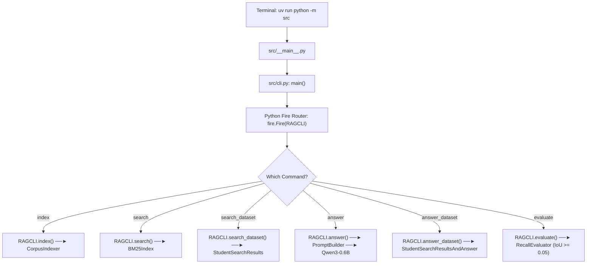

# Mandatory Part: Complete Code Execution Flow (Starting from `main`)

## 1. Overview

This document provides a **complete, step-by-step walkthrough of how Python reads and executes the code** across the entire mandatory RAG pipeline.

It tracks execution starting from the moment you hit Enter in the terminal down to the lowest-level functions and back to stdout/disk.



---

## 2. Step 1: Terminal Invocation & Environment Resolution

When you type:
```bash
uv run python -m src search "How to configure OpenAI server?" --k 5
```

1. **`uv run` activates the isolated environment:**
   `uv` checks the `.venv` directory (symlinked to `/goinfre/<user>/RAG_venv`), resolves `pyproject.toml` dependencies, sets `PATH` and `PYTHONPATH`, and executes the Python interpreter.
2. **`-m src` (Module Execution):**
   The Python interpreter is instructed to run the directory `src/` as a package. Python looks for `src/__main__.py`.
3. **`src/__main__.py` is executed:**
   ```python
   # File: src/__main__.py
   import sys
   from src.cli import main

   if __name__ == "__main__":
       sys.exit(main())
   ```
   Python assigns `__name__ = "__main__"`, evaluates the import, and calls `main()`.

---

## 3. Step 2: CLI Router Initialization (`src/cli.py:main`)

Inside `src/cli.py`:
```python
def main(args: Optional[Sequence[str]] = None) -> int:
    os.environ.setdefault("PAGER", "cat")
    try:
        fire.Fire(RAGCLI, command=list(args) if args is not None else None)
        return 0
    except SystemExit as exc:
        return int(exc.code) if exc.code is not None else 0
```

1. **Pager Guard:** `os.environ.setdefault("PAGER", "cat")` prevents Python Fire from pausing output inside an interactive `less` pager when run in terminal TTY mode.
2. **Fire Dispatch:** `fire.Fire(RAGCLI)` inspects the `RAGCLI` class:
   - Parses `sys.argv[1:]`: Subcommand name (e.g. `index`, `search`) and flags (`--k 5`, `--max_chunk_size 2000`).
   - Instantiates `RAGCLI()`. All constructor arguments in `RAGCLI.__init__(self, *, ...)` are keyword-only (`*`), guaranteeing that subcommands are never accidentally swallowed as constructor parameters.
   - Calls the matching method on the `RAGCLI` instance.

---

## 4. Step 3: Detailed Step-by-Step Execution of Each Command

---

### Command 1: `index [--max_chunk_size 2000]`

```bash
uv run python -m src index --max_chunk_size 2000
```

1. **`RAGCLI.index()` ([`src/cli.py`](../src/cli.py)):**
   - Validates `max_chunk_size` via `_sanitize_max_chunk_size()` (clamping between $1$ and $2000$).
   - Instantiates `CorpusIndexer(corpus_dir="data/raw/vllm-0.10.1", output_dir="data/processed", max_chunk_size=2000)`.
   - Calls `indexer.index()`.

2. **File Discovery ([`src/chunking/base.py`](../src/chunking/base.py)):**
   - `discover_files()` recursively walks `data/raw/vllm-0.10.1/`.
   - Skips `.git`, `.venv`, and `__pycache__`.
   - Checks `is_binary_file()` to reject binary artifacts.
   - Gathers 1,927 files (`.py`, `.md`, and `CMakeLists.txt`).

3. **Syntax-Aware Chunking ([`src/chunking/`](../src/chunking/)):**
   - Iterates through files with a `tqdm` progress bar (`"Indexing"`).
   - `.py` files $\rightarrow$ `PythonChunker.chunk_file()`:
     - Uses `ast.parse` to extract class definitions, standalone functions, and docstrings.
     - Computes exact UTF-8 0-based character offsets (`first_character_index`, `last_character_index`).
     - Subdivides classes $> 2000$ characters into method-level chunks.
   - `.md` files $\rightarrow$ `MarkdownChunker.chunk_file()`:
     - `find_code_fence_intervals()` flags all code blocks (```).
     - Partitions along ATX headings (`#` through `######`).
     - Subdivides sections $> 2000$ characters along paragraph (`\n\n`) boundaries without fracturing code fences.
   - `guard_chunks()` guarantees 100% of generated chunks have `span_length <= 2000`.
   - Produces 28,385 sequential `InternalChunk` records.

4. **Saving Chunks ([`src/indexing/indexer.py`](../src/indexing/indexer.py)):**
   - `save_chunks()` serializes all 28,385 chunks to `data/processed/chunks.json`.

5. **Tokenization & BM25 Index Construction ([`src/retrieval/bm25.py`](../src/retrieval/bm25.py)):**
   - Iterates through chunks with a `tqdm` progress bar (`"Tokenizing"`).
   - Runs `tokenize_code()`:
     - Splits `camelCase` and `snake_case` into lowercase sub-tokens while preserving composite symbols.
     - Enriches each chunk with its relative file path tokens and top-level section headings.
     - Strips conversational query stopwords (`"what"`, `"how"`, `"is"`, etc.).
   - `BM25Index.fit()`:
     - Computes document lengths and average document length (`avgdl`).
     - Precomputes the length normalization vector $K_d$.
     - Builds inverted index mapping `term -> PostingArray(doc_ids, term_frequencies)`.
     - Computes Robertson-Spärck Jones IDFs.
   - Serializes index to `data/processed/bm25_index.pkl` via `pickle.dump`.

6. **Terminal Output:**
   - `CorpusIndexer.index()` returns `IndexingResult`.
   - Its `__str__` returns `"Ingestion complete! Indices saved under data/processed"`.
   - Fire prints this string to stdout.

---

### Command 2: `search <query> [--k 5]`

```bash
uv run python -m src search "How to configure OpenAI server?" --k 5
```

1. **`RAGCLI.search()` ([`src/cli.py`](../src/cli.py)):**
   - Sanitizes query: `"How to configure OpenAI server?"`.
   - Parses $k$: effective $k=5$.
   - Calls `_get_or_load_ranker()`.

2. **Index Loading:**
   - Deserializes `data/processed/chunks.json` (via `load_chunks`) and `data/processed/bm25_index.pkl` (via `BM25Index.load`).

3. **Candidate Retrieval ([`src/retrieval/bm25.py`](../src/retrieval/bm25.py)):**
   - `BM25Index.get_scores()` tokenizes the query into tokens.
   - Looks up posting lists for each query token in $O(1)$.
   - Computes vectorized BM25 scores across candidate documents:
     $$\text{Score} = \text{IDF} \cdot \frac{\text{tf} \cdot (k_1 + 1)}{\text{tf} + K_d}$$
   - Uses `np.argpartition` to extract top 5 indices in $< 1\text{ ms}$.

4. **Source Formatting:**
   - Maps top 5 chunk indices to `MinimalSource` objects:
     ```json
     {
       "file_path": "data/raw/vllm-0.10.1/docs/serving/openai_compatible_server.md",
       "first_character_index": 9867,
       "last_character_index": 10100
     }
     ```
   - Clamps any span $> 2000$ chars to 2000.
   - Wraps result in `CLISearchResult`.

5. **Terminal Output:**
   - Serializes to formatted JSON conforming to `MinimalSearchResults` and prints to stdout.

---

### Command 3: `search_dataset --dataset_path ... --save_directory ... [--k 10]`

```bash
uv run python -m src search_dataset \
  --dataset_path data/datasets/UnansweredQuestions/dataset_docs_public.json \
  --save_directory data/output/search_results/UnansweredQuestions \
  --k 10
```

1. **`RAGCLI.search_dataset()` ([`src/cli.py`](../src/cli.py)):**
   - Verifies input file exists and parses JSON (`dataset_docs_public.json`).
   - Extracts all `(question_id, question)` pairs.
   - Resolves target save path:
     `data/output/search_results/UnansweredQuestions/dataset_docs_public.json`

2. **Batch Query Processing:**
   - Loops through all questions with `tqdm(desc="Searching dataset")`.
   - For each question:
     - Runs BM25 retrieval for top $k=10$ sources.
     - Clamps spans to $\le 2000$ characters.
     - Constructs a `MinimalSearchResults(question_id=..., question=..., retrieved_sources=[...])`.

3. **Disk Serialization:**
   - Constructs `StudentSearchResults(search_results=[...], k=10)`.
   - Validates the model against Pydantic schema rules.
   - Writes the JSON file to `save_directory`.
   - Prints:
     `Saved student_search_results to data/output/search_results/UnansweredQuestions/dataset_docs_public.json`

---

### Command 4: `answer <query> [--k 5]`

```bash
uv run python -m src answer "What HTTP endpoint dynamically loads a LoRA adapter?" --k 5
```

1. **`RAGCLI.answer()` ([`src/cli.py`](../src/cli.py)):**
   - Retrieves top-$k$ sources via BM25 retrieval.
   - Lazily instantiates `LLMInferenceEngine` ([`src/generation/llm.py`](../src/generation/llm.py)).

2. **Context Hydration & Prompt Construction ([`src/generation/prompt.py`](../src/generation/prompt.py)):**
   - `ContextLoader` hydrates each `MinimalSource` with text from memory or disk.
   - `PromptBuilder` formats headers:
     `[Source 1] file_path: data/raw/vllm-0.10.1/docs/features/lora.md | character_span: 4695-6098`
   - Builds chat messages (system prompt + user question + retrieved sources).
   - Applies Qwen chat template via tokenizer.

3. **CPU Model Inference ([`src/generation/llm.py`](../src/generation/llm.py)):**
   - Loads `Qwen/Qwen3-0.6B` weights into CPU memory with `torch.bfloat16`.
   - Executes inside `with torch.inference_mode():`.
   - Runs greedy decoding (`temperature=0.0`, `max_new_tokens=128`).
   - Decodes generated token IDs into natural language text:
     `"The /v1/load_lora_adapter endpoint is used to dynamically load a LoRA adapter in vLLM..."`

4. **Terminal Output:**
   - Constructs `CLIAnswerResult(MinimalAnswer)` and prints JSON to stdout.

---

### Command 5: `answer_dataset --student_search_results_path ... --save_directory ...`

```bash
uv run python -m src answer_dataset \
  --student_search_results_path data/output/search_results/UnansweredQuestions/dataset_docs_public.json \
  --save_directory data/output/search_results_and_answer/UnansweredQuestions
```

1. **`RAGCLI.answer_dataset()` ([`src/cli.py`](../src/cli.py)):**
   - Reads the student search results JSON file.
   - Validates with `StudentSearchResults.model_validate_json()`.

2. **Batch Inference Loop ([`src/generation/llm.py`](../src/generation/llm.py)):**
   - Loops through each question with `tqdm(desc="Answering dataset")`.
   - Re-uses the active `LLMInferenceEngine` in memory.
   - Generates grounded answer for each question.
   - Builds `MinimalAnswer` items.

3. **Disk Serialization:**
   - Wraps all items into `StudentSearchResultsAndAnswer(search_results=[...], k=10)`.
   - Saves file to `<save_directory>/dataset_docs_public.json`.
   - Prints:
     `Loaded 100 questions ... Processed 100 of 100 questions`
     `Saved student_search_results_and_answer to data/output/search_results_and_answer/UnansweredQuestions/dataset_docs_public.json`

---

### Command 6: `evaluate --student_search_results_path ... --dataset_path ... [--k 5]`

```bash
uv run python -m src evaluate \
  --student_search_results_path data/output/search_results/UnansweredQuestions/dataset_docs_public.json \
  --dataset_path data/datasets/AnsweredQuestions/dataset_docs_public.json \
  --k 5
```

1. **`RAGCLI.evaluate()` ([`src/cli.py`](../src/cli.py)):**
   - Calls `RecallEvaluator.evaluate_student_search_results()` ([`src/utils/evaluation.py`](../src/utils/evaluation.py)).

2. **Match Evaluation:**
   - Loads student predictions and ground-truth questions.
   - For every question and candidate source:
     - Verifies `candidate.file_path == ground_truth.file_path`.
     - Verifies `candidate.span_length <= 2000`.
     - Computes character Intersection-over-Union:
       $$\text{IoU} = \frac{\text{Intersection}}{\text{Union}} \ge 0.05$$
   - Records hits at $k \in \{1, 3, 5, 10\}$.

3. **Report Output:**
   - Computes Mean Recall@k.
   - Prints the summary table to stdout:
     ```text
     🎯 Evaluation Results
     ========================================
     📊 Questions evaluated: 100
     📈 Recall@1: 0.640 (64.0%)
     📈 Recall@3: 0.800 (80.0%)
     📈 Recall@5: 0.870 (87.0%)  <- docs threshold is 80% [PASS]
     📈 Recall@10: 0.890 (89.0%)
     ```

---

## 5. Process Exit

Once the chosen command finishes:
- `fire.Fire()` returns.
- `main()` returns integer exit code `0`.
- `sys.exit(0)` terminates the Python process cleanly, flushing all file descriptors and freeing allocated memory.
