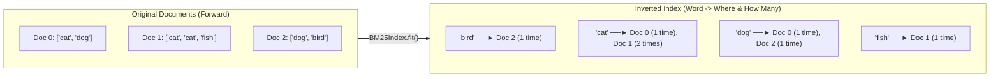
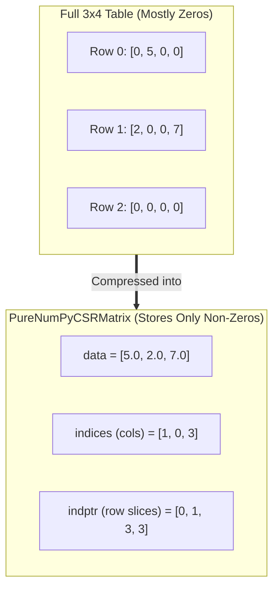
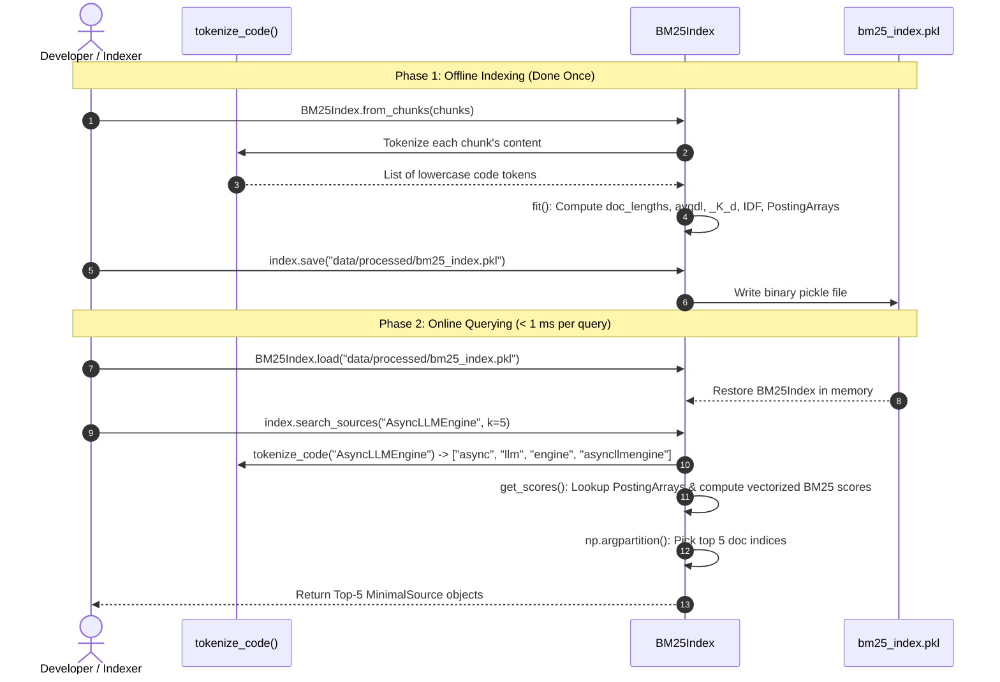

# Step-by-Step Beginner's Guide to `src/retrieval/bm25.py`

This guide explains **what BM25 is**, **how the math works**, and **how every line of code in [`src/retrieval/bm25.py`](../src/retrieval/bm25.py) works**—written step by step from the ground up.

---

## Table of Contents

1. [The Big Picture: What Problem Does `bm25.py` Solve?](#1-the-big-picture-what-problem-does-bm25py-solve)
2. [Core Concepts: How Search Engines Think](#2-core-concepts-how-search-engines-think)
3. [TF-IDF vs. BM25: What Is the Difference and Why Is BM25 Better?](#3-tf-idf-vs-bm25-what-is-the-difference-and-why-is-bm25-better)
4. [The Math Behind Okapi BM25 (Explained Simply)](#4-the-math-behind-okapi-bm25-explained-simply)
5. [Worked Hand-Calculated Example](#5-worked-hand-calculated-example)
6. [Code Walkthrough — Step by Step](#6-code-walkthrough--step-by-step)
   - [6.1 Imports, Type Hints, and Optional SciPy Fallback](#61-imports-type-hints-and-optional-scipy-fallback)
   - [6.2 `PostingArray`: Storing Which Documents Contain a Word](#62-postingarray-storing-which-documents-contain-a-word)
   - [6.3 `PureNumPyCSRMatrix`: Memory-Efficient Sparse Tables](#63-purenumpycsrmatrix-memory-efficient-sparse-tables)
   - [6.4 `BM25Index.__init__`: Setting Up the Search Engine](#64-bm25index__init__-setting-up-the-search-engine)
   - [6.5 `BM25Index.fit`: Building the Index from Documents](#65-bm25indexfit-building-the-index-from-documents)
   - [6.6 Factory Methods (`build`, `build_inverted_index`, `from_chunks`)](#66-factory-methods-build-build_inverted_index-from_chunks)
   - [6.7 `get_scores`: Fast Vectorized BM25 Scoring](#67-get_scores-fast-vectorized-bm25-scoring)
   - [6.8 `search`, `get_top_k`, and `search_sources`: Ranking the Winners](#68-search-get_top_k-and-search_sources-ranking-the-winners)
   - [6.9 `save` and `load`: Saving the Index to Disk](#69-save-and-load-saving-the-index-to-disk)
7. [End-to-End Lifecycle Diagram](#7-end-to-end-lifecycle-diagram)
8. [Quick Cheat Sheet](#8-quick-cheat-sheet)

---

## 1. The Big Picture: What Problem Does `bm25.py` Solve?

Imagine you have the entire `vLLM` codebase—almost **2,000 files** split into **~14,000–28,000 chunks** of Python code and Markdown documentation.

A user asks a question:
> *"How does `AsyncLLMEngine` configure `openai_compatible_server`?"*

We cannot feed all 28,000 chunks into the language model (`Qwen3-0.6B`) at once—it would be way too large and far too slow. Instead, we need a **search engine** that can look through all 28,000 chunks in **less than 1 millisecond** and pick the top $k$ (for example, top 5) most relevant chunks.

**BM25** (short for **Best Matching 25**, also called **Okapi BM25**) is the gold-standard keyword search algorithm used in search engines like Elasticsearch and Lucene.

### Why BM25 is ideal for code and documentation:
1. **Exact identifier matching:** When a developer searches for `AsyncEngineArgs` or `block_manager`, BM25 pinpoints the exact chunks containing those tokens.
2. **Blazingly fast on CPU:** It uses simple math and pre-built lookup tables, taking less than a millisecond per query with no GPU required.
3. **Zero external database servers:** Everything lives in Python and NumPy arrays and saves to a single file (`data/processed/bm25_index.pkl`).

---

## 2. Core Concepts: How Search Engines Think

Before reading the math or code, you only need to understand **three building blocks**:

### 2.1 Tokenization (Breaking Text into Words)
Before BM25 sees a document or a query, `tokenize_code()` turns raw text into a list of lowercase words (called **tokens** or **terms**):
```
"class AsyncEngine:"  ──►  ["class", "async", "engine", "asyncengine"]
```

### 2.2 The Naive Way vs. The Inverted Index
Suppose we have 3 small documents (chunks):
- **Doc 0:** `["cat", "dog"]`
- **Doc 1:** `["cat", "cat", "fish"]`
- **Doc 2:** `["dog", "bird"]`

If someone searches for `"fish"`, the **slow way** is to scan every single document from Doc 0 to Doc 28,000 to see if `"fish"` is inside.

Instead, `bm25.py` builds an **Inverted Index**—just like the index at the back of a textbook! It maps each **word** directly to the **list of documents** where that word appears, along with **how many times** it appears in each document:



Now, when someone searches for `"fish"`, we immediately look up `"fish"` in our dictionary and see that **only Doc 1** contains it! We never even touch Doc 0 or Doc 2.

---

## 3. TF-IDF vs. BM25: What Is the Difference and Why Is BM25 Better?

In the project specification, you can choose between two classic lexical retrieval methods: **TF-IDF** or **BM25**. During an evaluation or code defense, a very common question is:
> *"What is the difference between TF-IDF and BM25, and why is BM25 better for RAG over a codebase?"*

### 3.1 How TF-IDF Works
**TF-IDF** stands for **Term Frequency – Inverse Document Frequency**. It scores a document $D$ for a query $Q$ using a simple linear product:

$$\text{TF-IDF}(D, Q) = \sum_{q \in Q} \text{tf}(q, D) \times \text{IDF}(q)$$

Where:
- $\text{tf}(q, D)$ is the raw count of how many times word $q$ appears in document $D$.
- $\text{IDF}(q) = \ln\left(\frac{N}{\text{df}(q)}\right)$ measures how rare the word $q$ is across the corpus.

While TF-IDF was a great early invention in information retrieval, it has **two major mathematical flaws** that hurt search accuracy on codebases and technical documentation—and **BM25 was specifically invented to fix both of them**.

---

### 3.2 Flaw #1 in TF-IDF: Unbounded Linear Term Frequency (No Saturation)

- **In TF-IDF:** The score grows **linearly forever** with $\text{tf}(q, D)$. If a Python file repeats the variable name `engine` **30 times**, TF-IDF gives that file **30×** the score of a file that mentions `engine` once!
- **Why that breaks multi-word queries:**
  Suppose the user searches for **`"async engine"`**:
  - **Chunk A** is a giant general file that mentions `"engine"` **25 times**, and `"async"` **0 times**.
  - **Chunk B** is the exact `AsyncLLMEngine` class definition that mentions `"async"` **2 times** and `"engine"` **2 times**.
  - In **TF-IDF**, Chunk A's massive `25 × IDF("engine")` score easily beats Chunk B, even though Chunk A **completely misses the word `"async"`**!
- **How BM25 fixes this ($k_1 = 1.5$ saturation):**
  BM25 replaces raw $\text{tf}$ with a **saturating curve**:
  $$\text{BM25\_TF} = \frac{\text{tf} \cdot (k_1 + 1)}{\text{tf} + K_d}$$
  No matter how many times `"engine"` is repeated—10, 50, or 1,000 times—its multiplier **cannot exceed $k_1 + 1 = 2.5$**! Because a single repeated word can never dominate the score on its own, **Chunk B** (which matches *both* `"async"` and `"engine"`) wins decisively in BM25.

```
Score Contribution vs. Word Count (tf)

  TF-IDF (Linear - grows forever!)
  Score ^                        /
        |                      /
        |                    /
  2.5 --| - - - - - - - - -/- - - - - - - - -  <-- BM25 Asymptotic Ceiling (k1 + 1)
        |          _ . - '===================  <-- BM25 (Saturates smoothly!)
        |      . '
        |   . '
        | .'
      0 +------------------------------------> Word Count (tf) in Document
        0    1    2    5    10   20   50
```

---

### 3.3 Flaw #2 in TF-IDF: Unfair Bias Toward Long Documents

- **In TF-IDF:** A 2,000-character chunk naturally contains ~10× more words than a 200-character chunk. Even if a long chunk only mentions a keyword in passing, it has a much higher chance of accumulating raw word counts than a short, concise function or Markdown section.
- **How BM25 fixes this ($b = 0.75$ document length normalization):**
  BM25 explicitly compares each document's length $|D|$ against the **average document length** ($\text{avgdl}$) of the entire corpus:
  $$1 - b + b \cdot \frac{|D|}{\text{avgdl}}$$
  - If a chunk is **shorter** than average ($\frac{|D|}{\text{avgdl}} < 1$), its denominator $K_d$ is smaller, **boosting** its score because the matching keywords represent a high concentration of that chunk's meaning.
  - If a chunk is **longer** than average ($\frac{|D|}{\text{avgdl}} > 1$), its denominator $K_d$ is larger, **penalizing** it unless it genuinely has stronger evidence.

---

### 3.4 Side-by-Side Numerical Proof: TF-IDF Fails vs. BM25 Succeeds

Suppose a user searches for:
> **Query:** `"async engine"`

Assume both words have $\text{IDF}(\text{"async"}) = 3.0$ and $\text{IDF}(\text{"engine"}) = 1.5$, and both chunks have average length ($|D| = \text{avgdl}$, so in BM25 $K_d = k_1 = 1.5$):

| Candidate Chunk | `"async"` count ($\text{tf}$) | `"engine"` count ($\text{tf}$) | **TF-IDF Score** $\sum \text{tf} \cdot \text{IDF}$ | **BM25 Score** $\sum \text{IDF} \cdot \frac{\text{tf} \cdot 2.5}{\text{tf} + 1.5}$ |
| :--- | :---: | :---: | :---: | :---: |
| **Chunk A** *(Unrelated file repeating `engine`)* | `0` | `15` | $0 + 15 \times 1.5 =$ **$22.50$ (Wins ❌)** | $0 + 1.5 \times \frac{37.5}{16.5} =$ **$3.41$** |
| **Chunk B** *(Target `AsyncLLMEngine` class)* | `2` | `2` | $2 \times 3.0 + 2 \times 1.5 =$ **$9.00$ (Loses ❌)** | $3.0 \times \frac{5}{3.5} + 1.5 \times \frac{5}{3.5} =$ **$6.43$ (Wins ✅)** |

- **TF-IDF picks Chunk A** ($22.50 > 9.00$) because 15 repetitions of `"engine"` overwhelm the missing `"async"`.
- **BM25 picks Chunk B** ($6.43 > 3.41$) because `"engine"` saturates at `< 2.5×`, allowing the presence of both query terms (`"async"` + `"engine"`) to win!

---

### 3.5 Summary Comparison Table: TF-IDF vs. BM25

| Feature | TF-IDF | Okapi BM25 (Used in `bm25.py`) | Why BM25 Is Better |
| :--- | :--- | :--- | :--- |
| **Term Frequency ($\text{tf}$) Scaling** | Linear ($\text{tf}$) — unbounded | Saturating ($\frac{\text{tf}(k_1+1)}{\text{tf}+K_d}$) — bounded by $k_1+1$ | Prevents one repeated variable/keyword from drowning out other query words |
| **Document Length Handling** | None in raw TF-IDF (or rigid L2 norm) | Adaptive ratio $\frac{\|D\|}{\text{avgdl}}$ controlled by $b=0.75$ | Rewards concise functions/headings over long boilerplate files |
| **Tunable Hyperparameters** | None | $k_1 = 1.5$ (saturation), $b = 0.75$ (length penalty) | Can be tuned to match code and documentation structure |
| **IDF Formula** | $\ln(N / \text{df})$ | $\ln\left(1 + \frac{N - \text{df} + 0.5}{\text{df} + 0.5}\right)$ | Derived from Probabilistic Relevance Framework; smoothed & non-negative |
| **Recall@5 on Code & Docs** | Lower (vulnerable to keyword repetition) | **Significantly higher** ($\ge 80\%$ Docs, $\ge 50\%$ Code) | Directly prioritizes multi-term coverage over single-term spam |

---

## 4. The Math Behind Okapi BM25 (Explained Simply)

When a user searches for a query $Q$ made of words $q_1, q_2, \dots$, BM25 gives each document $D$ a **relevance score** by adding up a score for each query word that appears in $D$:

$$\text{Score}(D, Q) = \sum_{q \in Q} \text{IDF}(q) \times \frac{\text{tf}(q, D) \cdot (k_1 + 1)}{\text{tf}(q, D) + k_1 \cdot \left(1 - b + b \cdot \frac{|D|}{\text{avgdl}}\right)}$$

That formula looks intimidating at first, so let's break it into **three simple ideas**:

---

### Idea 1: Rare words matter more than common words — $\text{IDF}(q)$

**IDF** stands for **Inverse Document Frequency**.
- Suppose a query is `"the AsyncLLMEngine"`.
- The word `"the"` (or `"def"`, `"self"`, `"return"`) appears in almost every document. Matching `"the"` tells us almost nothing.
- The word `"asyncllmengine"` appears in only 3 documents out of 28,000. Matching `"asyncllmengine"` is a huge clue!

BM25 measures how rare a word $q$ is using:

$$\text{IDF}(q) = \ln\left(1 + \frac{N - \text{df}(q) + 0.5}{\text{df}(q) + 0.5}\right)$$

Where:
- $N$ (`num_docs`): Total number of documents in the corpus.
- $\text{df}(q)$ (**Document Frequency**): Number of documents that contain the word $q$ at least once.
- $+0.5$ and $+1$: Smoothing constants so we never divide by zero and the score is never negative.

> **Intuition:**
> - If $\text{df}(q)$ is tiny (a rare word), $\frac{N - \text{df}(q) + 0.5}{\text{df}(q) + 0.5}$ is huge, so $\text{IDF}(q)$ is **high**.
> - If $\text{df}(q) = N$ (every document has the word), $\text{IDF}(q)$ is **very close to 0**.

---

### Idea 2: Appearing more times helps, with diminishing returns — $\text{tf}(q, D)$ and $k_1$

**TF** ($\text{tf}(q, D)$) stands for **Term Frequency**: how many times the word $q$ appears inside document $D$.

If a document mentions `"lora"` 3 times, it is probably more about LoRA than a document that mentions `"lora"` once.
**However**, a document that mentions `"lora"` 100 times isn't 100× more relevant than one that mentions it 5 times!

The parameter **$k_1 = 1.5$** controls **term frequency saturation** (diminishing returns):
- Going from $\text{tf}=0 \to 1$ gives a big jump.
- Going from $\text{tf}=1 \to 2$ gives a medium boost.
- Going from $\text{tf}=10 \to 50$ barely changes the score at all (it caps out at $k_1 + 1 = 2.5$).

---

### Idea 3: Short, focused documents beat long,rambling ones — $\frac{|D|}{\text{avgdl}}$ and $b$

Suppose two documents both mention `"lora"` **once**:
- **Doc A** is a short 20-word heading specifically about LoRA.
- **Doc B** is a giant 500-word file that casually mentions LoRA once at the bottom.

Doc A should win because `"lora"` makes up a much larger portion of Doc A!

BM25 measures how long a document is compared to the average document:
- $|D|$ (`doc_lengths[d]`): Number of tokens in document $D$.
- $\text{avgdl}$: Average number of tokens across all documents in the corpus.
- $\frac{|D|}{\text{avgdl}}$: Length ratio ($< 1.0$ if the document is shorter than average; $> 1.0$ if longer than average).
- **$b = 0.75$**: Controls how strongly we penalize long documents ($b=0$ means ignore document length completely; $b=1$ means full length penalty).

In `bm25.py`, the denominator part $k_1 \cdot \left(1 - b + b \cdot \frac{|D|}{\text{avgdl}}\right)$ only depends on the document $D$, not on the query! So `bm25.py` **pre-computes** this once per document and saves it in an array called `self._K_d`:

$$K_d = k_1 \cdot \left(1 - b + b \cdot \frac{|D|}{\text{avgdl}}\right)$$

With $K_d$ pre-computed, the query-time formula becomes super simple:

$$\text{Score}(D, Q) = \sum_{q \in Q} \text{IDF}(q) \times \text{qtf}(q) \times \frac{\text{tf}(q, D) \cdot (k_1 + 1)}{\text{tf}(q, D) + K_d}$$

*(where $\text{qtf}(q)$ is how many times the word $q$ appears in the user's query).*

---

## 5. Worked Hand-Calculated Example

Let's trace the exact math used in `tests/test_retrieval_bm25.py`!

Suppose we have $N = 2$ documents and default parameters $k_1 = 1.5, b = 0.75$:
- **Doc 0:** `["cat", "dog"]` $\rightarrow$ length $|D_0| = 2$
- **Doc 1:** `["cat", "cat", "fish"]` $\rightarrow$ length $|D_1| = 3$

### Step 1: Average Document Length ($\text{avgdl}$)
$$\text{avgdl} = \frac{2 + 3}{2} = 2.5$$

### Step 2: Pre-compute Length Penalty $K_d$ for each document
- **For Doc 0** ($|D_0| = 2$):
  $$\text{len\_ratio}_0 = \frac{2}{2.5} = 0.8$$
  $$K_0 = 1.5 \times (1 - 0.75 + 0.75 \times 0.8) = 1.5 \times (0.25 + 0.60) = 1.5 \times 0.85 = 1.275$$
- **For Doc 1** ($|D_1| = 3$):
  $$\text{len\_ratio}_1 = \frac{3}{2.5} = 1.2$$
  $$K_1 = 1.5 \times (1 - 0.75 + 0.75 \times 1.2) = 1.5 \times (0.25 + 0.90) = 1.5 \times 1.15 = 1.725$$

### Step 3: Compute IDF for `"cat"`
`"cat"` appears in both Doc 0 and Doc 1, so $\text{df}(\text{"cat"}) = 2$ out of $N = 2$:
$$\text{IDF}(\text{"cat"}) = \ln\left(1 + \frac{2 - 2 + 0.5}{2 + 0.5}\right) = \ln\left(1 + \frac{0.5}{2.5}\right) = \ln(1.2) \approx 0.18232$$

### Step 4: Score the Query `["cat"]`
- **Doc 0** has $\text{tf}(\text{"cat"}, D_0) = 1$:
  $$\text{Score}(D_0) = 0.18232 \times \frac{1 \times (1.5 + 1)}{1 + 1.275} = 0.18232 \times \frac{2.5}{2.275} \approx 0.20035$$
- **Doc 1** has $\text{tf}(\text{"cat"}, D_1) = 2$:
  $$\text{Score}(D_1) = 0.18232 \times \frac{2 \times (1.5 + 1)}{2 + 1.725} = 0.18232 \times \frac{5.0}{3.725} \approx 0.24473$$

**Winner:** Doc 1 ($0.24473 > 0.20035$) because `"cat"` appears twice in Doc 1!

---

## 6. Code Walkthrough — Step by Step

Now let's walk through [`src/retrieval/bm25.py`](../src/retrieval/bm25.py) from top to bottom.

---

### 6.1 Imports, Type Hints, and Optional SciPy Fallback (Lines 1–46)

```python
try:
    from scipy.sparse import csr_matrix, spmatrix
    _HAS_SCIPY = True
except ImportError:
    csr_matrix = None
    spmatrix = None
    _HAS_SCIPY = False

from src.indexing.schema import InternalChunk
from src.models import MinimalSource
from src.retrieval.tokenizer import tokenize_code

DEFAULT_INDEX_PATH = Path("data/processed/bm25_index.pkl")
```

**What this does:**
1. Tries to import `scipy.sparse.csr_matrix` if SciPy is installed. If SciPy is not installed, it sets `_HAS_SCIPY = False` and falls back to our own `PureNumPyCSRMatrix` class so the code **never crashes** due to missing optional packages.
2. Imports `InternalChunk` (our internal chunk record), `MinimalSource` (the output location schema required by the moulinette), and `tokenize_code` (our code-aware tokenizer).
3. Sets the default save path `data/processed/bm25_index.pkl`.

---

### 6.2 `PostingArray`: Storing Which Documents Contain a Word (Lines 49–99)

In an inverted index, the entry for a single word is called a **Posting List**.
For example, if the word `"engine"` appears:
- in **Doc 0** (`3` times),
- in **Doc 4** (`1` time),
- in **Doc 9** (`2` times),

then `"engine"` has two parallel lists of numbers:
- `doc_ids = [0, 4, 9]` (stored as 32-bit integers `np.int32`)
- `term_frequencies = [3.0, 1.0, 2.0]` (stored as 32-bit floats `np.float32`)

```python
class PostingArray(_PostingArrayBase):
    doc_ids: NDArray[np.int32]
    term_frequencies: NDArray[np.float32]

    def __new__(
        cls,
        doc_ids: Union[Sequence[int], NDArray[Any]],
        term_frequencies: Union[Sequence[Union[float, int]], NDArray[Any]],
    ) -> PostingArray:
        arr = np.asarray(doc_ids, dtype=np.int32)
        obj = arr.view(cls)
        obj.doc_ids = arr
        obj.term_frequencies = np.asarray(term_frequencies, dtype=np.float32)
        return obj
```

**Why subclass `np.ndarray` (`_PostingArrayBase`)?**
- By subclassing `np.ndarray`, a `PostingArray` **is** a 1D NumPy array of `doc_ids`, AND it carries `.doc_ids` and `.term_frequencies` (plus aliases `.frequencies` and `.tfs`) right on the object!
- `__array_finalize__` is a special NumPy hook called whenever a NumPy array is sliced or viewed, ensuring `.doc_ids` and `.term_frequencies` are always initialized.
- `__reduce__` tells Python's `pickle` module how to save and reload `PostingArray` cleanly when writing `bm25_index.pkl`.

---

### 6.3 `PureNumPyCSRMatrix`: Memory-Efficient Sparse Tables (Lines 101–148)

What is a **Term Frequency Matrix**?
It is a table where:
- Every **row** is a document (`0` to `num_docs - 1`),
- Every **column** is a word in the vocabulary (`0` to `vocab_size - 1`),
- Cell `(row, col)` holds how many times that word appears in that document.

**The problem with a normal ("dense") table:**
If you have $28,000$ documents and $40,000$ unique words, a full table has:
$$28,000 \times 40,000 = 1,120,000,000 \text{ cells } (\sim 4.5\text{ GB of RAM!})$$
And **99.9% of those cells are `0`** because each short chunk only contains ~50 words!

**The solution — CSR (Compressed Sparse Row) Matrix:**
Instead of storing billions of zeros, `PureNumPyCSRMatrix` only stores the **non-zero** numbers using three compact 1D arrays:
1. `data`: The non-zero word counts (e.g., `[5.0, 2.0, 7.0]`).
2. `indices`: Which column (word ID) each non-zero count belongs to (e.g., `[1, 0, 3]`).
3. `indptr` (Index Pointer): Where each document's row starts and ends inside `data` and `indices`.



- `.toarray()` reconstructs the full 2D NumPy table when needed.
- `__getitem__((row, col))` lets you look up `matrix[doc_id, word_id]` directly.

---

### 6.4 `BM25Index.__init__`: Setting Up the Search Engine (Lines 163–190)

```python
    def __init__(
        self,
        corpus: Optional[Sequence[Sequence[str]]] = None,
        k1: float = 1.5,
        b: float = 0.75,
        tokenizer: Optional[Callable[[str], List[str]]] = None,
        store_dense: Optional[bool] = None,
    ) -> None:
```

Here we initialize all the state variables of our index:
| Attribute | Type | Meaning |
| :--- | :--- | :--- |
| `self.k1` | `float` | Term frequency saturation parameter (default `1.5`) |
| `self.b` | `float` | Document length normalization parameter (default `0.75`) |
| `self.tokenizer` | `Callable` | Function converting a string into tokens (default `tokenize_code`) |
| `self.num_docs` | `int` | Total number of indexed documents ($N$) |
| `self.doc_lengths` | `NDArray[np.int32]` | 1D array where `doc_lengths[i]` is the token count of document `i` |
| `self.avgdl` | `float` | Average document length across the corpus |
| `self.vocabulary` | `Dict[str, int]` | Maps each word $\rightarrow$ column index (`0 .. V-1`) |
| `self.terms` | `List[str]` | Sorted list of all unique words in the vocabulary |
| `self.idf` | `Dict[str, float]` | Maps each word $\rightarrow$ its precomputed $\text{IDF}(q)$ score |
| `self.inverted_index` | `Dict[str, PostingArray]` | Maps each word $\rightarrow$ its `PostingArray(doc_ids, term_frequencies)` |
| `self._K_d` | `NDArray[np.float32]` | Precomputed length normalization denominator $K_d$ for each document |
| `self.chunks` | `Optional[List[Any]]` | Stored `InternalChunk` objects (so we can return `MinimalSource`s) |
| `self.chunk_ids` | `Optional[List[int]]` | Sequential chunk IDs corresponding to each document row |

If `corpus` is passed right away to `BM25Index(corpus)`, it automatically calls `self.fit(corpus)`!

---

### 6.5 `BM25Index.fit`: Building the Index from Documents (Lines 220–316)

`fit()` takes a list of tokenized documents (`Sequence[Sequence[str]]`) and builds the index in **three passes**:

#### Pass 1: Compute Document Lengths and $K_d$ (Lines 238–249)
```python
self.num_docs = len(corpus_tokens)
self.doc_lengths = np.array([len(doc) for doc in corpus_tokens], dtype=np.int32)
self.avgdl = float(np.mean(self.doc_lengths)) if self.num_docs > 0 else 0.0

if self.avgdl > 0:
    len_ratio = self.doc_lengths.astype(np.float32) / self.avgdl
else:
    len_ratio = np.zeros(self.num_docs, dtype=np.float32)
self._K_d = (self.k1 * (1.0 - self.b + self.b * len_ratio)).astype(np.float32)
```
This computes $N$, $|D|$ for every document, $\text{avgdl}$, and the entire array `self._K_d` in one vectorized NumPy operation.

#### Pass 2: Count Words and Build the Inverted Index + IDFs (Lines 250–273)
```python
postings_builder: Dict[str, Tuple[List[int], List[int]]] = {}
for doc_id, doc in enumerate(corpus_tokens):
    counts = Counter(doc)
    for term, freq in counts.items():
        if term not in postings_builder:
            postings_builder[term] = ([], [])
        postings_builder[term][0].append(doc_id)
        postings_builder[term][1].append(freq)
```
- `Counter(doc)` counts how many times each unique word appears in `doc`.
- For each word `term`, we append `doc_id` to its document list and `freq` to its frequency list.
- Next, we convert each `(doc_ids, freqs)` pair into a `PostingArray` and compute its IDF:
  ```python
  for term, (doc_ids, freqs) in postings_builder.items():
      self.inverted_index[term] = PostingArray(doc_ids, freqs)
      df = len(doc_ids)
      idf_val = math.log(1.0 + (n_docs - df + 0.5) / (df + 0.5))
      self.idf[term] = float(idf_val)
  ```

#### Pass 3: Build the Term Frequency Matrix (Lines 274–316)
- If the corpus is small (`num_docs * vocab_size <= 10,000,000`, or `store_dense=True`), it builds a regular 2D NumPy array `dense_tf`.
- If the corpus is large (like the full `vLLM` repository), it builds a compact CSR sparse matrix so memory usage stays tiny.

---

### 6.6 Factory Methods (`build`, `build_inverted_index`, `from_chunks`) (Lines 318–401)

To make `BM25Index` easy to create from anything, `bm25.py` provides three helper classmethods:
1. **`BM25Index.build(corpus_tokens, ...)`**: Creates a `BM25Index` from already-tokenized lists of strings.
2. **`BM25Index.build_inverted_index(chunks, ...)`**: Accepts a list of:
   - `InternalChunk` objects (extracts `item.content`, tokenizes it, and saves the `InternalChunk` metadata in `index.chunks` and `item.chunk_id` in `index.chunk_ids`),
   - OR raw `str` documents (tokenizes each string),
   - OR already-tokenized `Sequence[str]` lists.
3. **`BM25Index.from_chunks(chunks, ...)`**: Clean alias for `build_inverted_index(chunks, ...)`.

---

### 6.7 `get_scores`: Fast Vectorized BM25 Scoring (Lines 403–439)

This is the heart of query-time retrieval! Let's look at every line:

```python
    def get_scores(self, query: Union[str, Sequence[str]]) -> NDArray[np.float32]:
        if self.num_docs == 0:
            return np.array([], dtype=np.float32)

        if isinstance(query, str):
            query_tokens = self.tokenizer(query)
        else:
            query_tokens = [t.lower() for t in query]

        if not query_tokens:
            return np.zeros(self.num_docs, dtype=np.float32)

        scores = np.zeros(self.num_docs, dtype=np.float32)
        query_counts = Counter(query_tokens)

        k1 = self.k1
        k_d = self._K_d

        for term, qtf in query_counts.items():
            if term not in self.inverted_index:
                continue
            posting = self.inverted_index[term]
            doc_ids = posting.doc_ids
            tfs = posting.term_frequencies
            idf_val = self.idf[term]

            # Vectorized Okapi BM25 candidate scoring
            denom = tfs + k_d[doc_ids]
            term_score = (idf_val * qtf) * (tfs * (k1 + 1.0)) / denom
            scores[doc_ids] += term_score

        return scores
```

**Why is this so fast (< 0.5 ms across 14,000+ documents)?**
1. We start with `scores = np.zeros(self.num_docs, dtype=np.float32)`.
2. We loop **only over the unique words in the query** (usually 3 to 8 words!).
3. If a query word isn't in `self.inverted_index`, we `continue` immediately.
4. If the query word IS in `self.inverted_index`, we grab `doc_ids` (only the documents that contain that word!) and `tfs` (their term frequencies).
5. Look at these three lines of NumPy magic:
   ```python
   denom = tfs + k_d[doc_ids]
   term_score = (idf_val * qtf) * (tfs * (k1 + 1.0)) / denom
   scores[doc_ids] += term_score
   ```
   There is **no Python `for` loop over documents**! NumPy computes the BM25 equation in C for all matching documents simultaneously and adds their scores directly into `scores[doc_ids]`.

---

### 6.8 `search`, `get_top_k`, and `search_sources`: Ranking the Winners (Lines 444–531)

Once `get_scores(query)` gives us the array of scores for all documents, we want the top $k$ highest-scoring documents.

#### 1. `search(query, k=5, filter_zero=True) -> List[Tuple[int, float]]`
Returns a list of `(doc_index, score)` tuples sorted from highest score to lowest:
- If `filter_zero=True` (the default), we first discard all documents with `score == 0` using `matching_indices = np.flatnonzero(scores > 0)`.
- **Fast Top-$k$ Selection with `np.argpartition`:**
  Sorting all 14,000 documents takes $O(M \log M)$ time.
  Instead, when there are more than $k$ matching documents, `bm25.py` uses **`np.argpartition(-matching_scores, k)[:k]`**, which finds the top $k$ elements in **$O(M)$ linear time**, and then only sorts those $k$ winners!

#### 2. `get_top_k(query, k=5, filter_zero=True) -> List[int]`
Calls `self.search(...)` and returns just the integer `chunk_id`s (or document indices) of the top $k$ winners:
```python
[1, 0, 3]
```

#### 3. `search_sources(query, k=5, filter_zero=True) -> List[MinimalSource]`
Calls `self.search(...)`, looks up each winning `InternalChunk` in `self.chunks[doc_idx]`, and converts it via `chunk.to_source()` into a `MinimalSource(file_path=..., first_character_index=..., last_character_index=...)`.

---

### 6.9 `save` and `load`: Saving the Index to Disk (Lines 533–575)

- **`index.save(file_path)`** (and helper `save_bm25_index`):
  Creates parent directories (`data/processed/`) if they don't exist and writes the entire `BM25Index` object to disk in fast binary format using `pickle.dump(..., protocol=pickle.HIGHEST_PROTOCOL)`.
- **`BM25Index.load(file_path)`** (and helper `load_bm25_index`):
  Checks that the file exists, loads the binary pickle file back into memory in milliseconds, verifies its type is `BM25Index`, and returns the ready-to-search index.

---

## 7. End-to-End Lifecycle Diagram



---

## 8. Quick Cheat Sheet

| Task | Code to Use | What It Returns |
| :--- | :--- | :--- |
| **Build from `InternalChunk`s** | `index = BM25Index.from_chunks(chunks)` | Fitted `BM25Index` with chunk metadata attached |
| **Build from token lists** | `index = BM25Index(tokenized_docs)` | Fitted `BM25Index` |
| **Get all document scores** | `scores = index.get_scores("openai server")` | `1D np.ndarray` of `float32` scores (length = `num_docs`) |
| **Get top-$k$ `(doc_idx, score)`** | `results = index.search("openai server", k=5)` | `List[Tuple[int, float]]` sorted best-first |
| **Get top-$k$ chunk IDs** | `ids = index.get_top_k("openai server", k=5)` | `List[int]` |
| **Get top-$k$ `MinimalSource`s** | `sources = index.search_sources("openai server", k=5)` | `List[MinimalSource]` |
| **Save index to disk** | `index.save("data/processed/bm25_index.pkl")` | `Path` to saved `.pkl` file |
| **Load index from disk** | `index = BM25Index.load("data/processed/bm25_index.pkl")` | Restored `BM25Index` instance |
