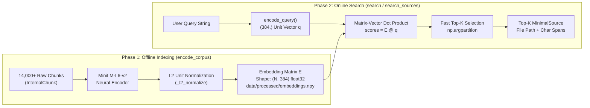

# Beginner's Step-by-Step Guide to Dense Semantic Retrieval (`src/retrieval/dense.py`)

This guide explains **what** `src/retrieval/dense.py` is, **why** we need it alongside BM25 in our RAG pipeline, **how** dense vector embeddings and cosine similarity work mathematically (from zero), and walks through **every single class, method, and line of code** in `src/retrieval/dense.py`.

---

## 1. The Big Picture: What Is `dense.py` and What Does It Do?

### What Problem Does It Solve?
In our previous guide (`docs/bm25_step_by_step_guide.md`), we saw how **BM25** acts as a fast **keyword search engine**. However, keyword search has a fundamental blind spot known as the **Vocabulary Mismatch Problem** (or Synonym Problem):

Imagine a user asks:
> *"How do I reduce GPU memory usage when serving large models?"*

And suppose a chunk in the vLLM documentation says:
> *"To lower VRAM footprint during inference, enable weight quantization (`--quantization awq`)."*

Notice what happens if you only use keyword matching (BM25):
- `"reduce"` $\neq$ `"lower"`
- `"GPU memory"` $\neq$ `"VRAM"`
- `"usage"` $\neq$ `"footprint"`
- `"serving"` $\neq$ `"inference"`

Because **zero keywords overlap**, a pure keyword search engine gives this chunk a score of `0.0`—even though it is the exact answer the user needs!

### How `dense.py` Solves This
`src/retrieval/dense.py` implements **Dense Semantic Retrieval** (powered by the neural network `sentence-transformers/all-MiniLM-L6-v2`). Instead of counting exact words, it converts the **meaning** of a piece of text into a list of **384 floating-point numbers** called a **dense vector** (or **embedding**).

Texts with similar meanings get mapped to nearby points in this 384-dimensional space—even if they share no words in common!



---

## 2. Core Concepts: What Is a "Dense Vector Embedding"?

### Why Is It Called "Dense" (vs. "Sparse")?
1. **Sparse Vectors (TF-IDF / BM25):**
   If your codebase vocabulary has 50,000 unique words, a traditional bag-of-words representation gives every chunk a 50,000-slot array where each slot corresponds to one exact word. Since a short paragraph only uses ~40 unique words, **49,960 slots are `0`**. Because it is mostly zeros, it is called a **sparse vector**.
2. **Dense Vectors (`dense.py`):**
   Instead of 50,000 mostly-zero slots tied to exact words, our neural network (`all-MiniLM-L6-v2`) compresses the *meaning* of a text chunk into **384 numbers**, where **almost every single number is non-zero** (e.g., `[-0.041, 0.128, -0.009, ..., 0.073]`). Because every slot carries continuous semantic information, it is called a **dense vector**.

### Intuition: Meaning as Coordinates on a Map
Think of a 2D map where:
- **Dimension 1 (East–West)** measures *"Hardware / GPU vs. High-Level API"*
- **Dimension 2 (North–South)** measures *"Memory Optimization vs. Throughput Scheduling"*

On this 2D map:
- `"reduce GPU memory"` might land at coordinates `(0.80, 0.60)`.
- `"lower VRAM footprint"` lands right next to it at `(0.79, 0.61)`.
- `"HTTP FastAPI server endpoint"` lands far away at `(-0.70, -0.71)`.

`all-MiniLM-L6-v2` does the exact same thing, except instead of 2 dimensions, its map has **384 dimensions** learned from ratusan millions of text pairs!

---

## 3. Lexical (BM25) vs. Dense Semantic Search

Why do we have **both** `bm25.py` and `dense.py` in `src/retrieval/` (and combine them in `hybrid.py`)? Because each method covers the other's weaknesses:

| Feature | Lexical Search (`bm25.py`) | Dense Semantic Search (`dense.py`) |
| :--- | :--- | :--- |
| **How it represents text** | Bag of exact tokens (`["kv", "cache"]`) | 384-D continuous float32 vector $\mathbf{v} \in \mathbb{R}^{384}$ |
| **Synonyms & Paraphrases** | **Poor** — misses `"VRAM"` when searching `"GPU memory"` | **Excellent** — maps both to nearly identical vectors |
| **Exact Code Identifiers** | **Excellent** — matches `AsyncLLMEngine` or `CUDA_VISIBLE_DEVICES` verbatim | **Moderate** — neural models may blur rare variable names or error codes |
| **Conceptual / "How-to" Queries** | **Moderate** — relies on word overlap | **Excellent** — captures intent and semantic context |
| **Indexing Speed (CPU)** | **Very Fast** (~1–2 seconds for 14k chunks) | **Heavier** (~1–3 minutes on CPU to run neural network forward passes) |
| **Query Speed (CPU)** | **Fast** (~2–10 ms) | **Fast** (~10–25 ms using vectorized BLAS matrix multiplication) |

> [!TIP]
> By fusing **BM25** (exact code symbols) and **Dense Retrieval** (semantic concepts) using Reciprocal Rank Fusion (`src/retrieval/hybrid.py`), our RAG system gets the best of both worlds!

---

## 4. The Math Behind `dense.py` (Step-by-Step for Beginners)

Once the neural network gives us a 384-number vector for every chunk and a 384-number vector for the user's query, **how do we measure how close two vectors are?**

We use three simple mathematical building blocks:
1. **Dot Product** ($\mathbf{a} \cdot \mathbf{b}$)
2. **Euclidean (L2) Norm / Length** ($\|\mathbf{v}\|_2$)
3. **L2 Normalization & Cosine Similarity** ($\cos(\theta)$)

Let's break each one down from scratch.

---

### Step 4.1: The Dot Product ($\mathbf{a} \cdot \mathbf{b}$)
Given two vectors $\mathbf{a} = [a_1, a_2, \dots, a_D]$ and $\mathbf{b} = [b_1, b_2, \dots, b_D]$ of the same length $D$, their **dot product** simply multiplies matching positions together and adds them up:

$$\mathbf{a} \cdot \mathbf{b} = \sum_{i=1}^{D} a_i b_i = a_1 b_1 + a_2 b_2 + \dots + a_D b_D$$

- If $\mathbf{a}$ and $\mathbf{b}$ have the same signs in the same positions (both positive or both negative), $a_i b_i > 0$, producing a **large positive** sum.
- If they point in unrelated directions, positive and negative products cancel out near **`0.0`**.
- If they point in opposite directions, the sum is **negative**.

---

### Step 4.2: The Euclidean (L2) Norm ($\|\mathbf{v}\|_2$)
The **L2 norm** (also called Euclidean length or magnitude) measures the straight-line length of a vector from the origin $(0, 0, \dots, 0)$ to its tip—just like the Pythagorean theorem ($a^2 + b^2 = c^2$) in 2D or 3D:

$$\|\mathbf{v}\|_2 = \sqrt{\sum_{i=1}^{D} v_i^2} = \sqrt{v_1^2 + v_2^2 + \dots + v_D^2}$$

---

### Step 4.3: L2 Unit Normalization ($\hat{\mathbf{v}}$)
Different vectors coming out of a neural network might have slightly different lengths (norms). To compare only the **direction** (meaning) of two vectors without being biased by their arrow lengths, we shrink or stretch every vector so its length becomes **exactly `1.0`**.

We do this by dividing every element of $\mathbf{v}$ by its L2 norm $\|\mathbf{v}\|_2$:

$$\hat{\mathbf{v}} = \frac{\mathbf{v}}{\|\mathbf{v}\|_2} = \left[ \frac{v_1}{\|\mathbf{v}\|_2},\; \frac{v_2}{\|\mathbf{v}\|_2},\; \dots,\; \frac{v_D}{\|\mathbf{v}\|_2} \right]$$

After this step, $\|\hat{\mathbf{v}}\|_2 = 1.0$. A vector with length `1.0` is called a **unit vector** (written with a hat $\hat{\mathbf{v}}$), and all unit vectors sit on the surface of a 384-dimensional sphere of radius 1!

---

### Step 4.4: Cosine Similarity and the "Unit Vector Shortcut"
In geometry, the **Cosine Similarity** between a document vector $\mathbf{d}$ and a query vector $\mathbf{q}$ measures the cosine of the angle $\theta$ between them:

$$\text{CosineSimilarity}(\mathbf{d}, \mathbf{q}) = \cos(\theta) = \frac{\mathbf{d} \cdot \mathbf{q}}{\|\mathbf{d}\|_2 \, \|\mathbf{q}\|_2}$$

- $\cos(0^\circ) = \mathbf{+1.0}$: Vectors point in the **exact same direction** (identical meaning).
- $\cos(90^\circ) = \mathbf{0.0}$: Vectors are perpendicular (**unrelated** meaning).
- $\cos(180^\circ) = \mathbf{-1.0}$: Vectors point in **opposite** directions.

#### Why `dense.py` Pre-Normalizes All Vectors (The Speed Trick!)
Look closely at the denominator of the Cosine Similarity formula: $\|\mathbf{d}\|_2 \, \|\mathbf{q}\|_2$.
If we had to compute square roots and norms for 14,000 documents every single time a user typed a query, search would be slower.

Instead, in `dense.py`, we **L2-normalize** every document vector $\hat{\mathbf{d}}$ *once* when building the index (`|\hat{\mathbf{d}}\|_2 = 1$), and we **L2-normalize** the query vector $\hat{\mathbf{q}}$ (`\|\hat{\mathbf{q}}\|_2 = 1`).
When both norms equal `1`, the denominator disappears (`1 * 1 = 1`):

$$\cos(\theta) = \frac{\hat{\mathbf{d}} \cdot \hat{\mathbf{q}}}{1 \times 1} = \hat{\mathbf{d}} \cdot \hat{\mathbf{q}} = \sum_{i=1}^{384} \hat{d}_i \hat{q}_i$$

And even better: if we stack all $N$ normalized document vectors as rows of a matrix $\mathbf{E} \in \mathbb{R}^{N \times 384}$, we can compute the cosine similarity against **all $N$ documents at once** using a single matrix-vector multiplication (`self.embeddings @ q_vec` in NumPy):

$$\mathbf{s} = \mathbf{E} \hat{\mathbf{q}}$$

where $s_i = \hat{\mathbf{d}}_i \cdot \hat{\mathbf{q}}$ is the exact cosine similarity for chunk $i$. NumPy delegates `@` to C/Fortran BLAS (OpenBLAS/MKL) with SIMD instructions, scoring 14,000+ chunks in **under 5 milliseconds** on a laptop CPU!

---

## 5. Worked Hand-Calculated Numerical Example

To make the math 100% concrete, let's trace `dense.py` by hand using tiny **3-dimensional** vectors ($D = 3$ instead of $384$) and **2 chunks** ($N = 2$):

- **Chunk 0** (about GPU memory): raw neural output $\mathbf{d}_0 = [3.0, 4.0, 0.0]$
- **Chunk 1** (about HTTP server): raw neural output $\mathbf{d}_1 = [0.0, 0.0, 2.0]$

### Step 1: L2-Normalize the Corpus (`_l2_normalize` in `encode_corpus`)
1. **For Chunk 0** ($\mathbf{d}_0 = [3.0, 4.0, 0.0]$):
   - Compute L2 norm:
     $$\|\mathbf{d}_0\|_2 = \sqrt{3.0^2 + 4.0^2 + 0.0^2} = \sqrt{9 + 16 + 0} = \sqrt{25} = 5.0$$
   - Divide by norm `5.0`:
     $$\hat{\mathbf{d}}_0 = \left[\frac{3.0}{5.0},\; \frac{4.0}{5.0},\; \frac{0.0}{5.0}\right] = [0.6, 0.8, 0.0]$$
   - Check unit length: $\sqrt{0.6^2 + 0.8^2 + 0^2} = \sqrt{0.36 + 0.64} = \sqrt{1.0} = 1.0$ ✔

2. **For Chunk 1** ($\mathbf{d}_1 = [0.0, 0.0, 2.0]$):
   - Compute L2 norm:
     $$\|\mathbf{d}_1\|_2 = \sqrt{0.0^2 + 0.0^2 + 2.0^2} = \sqrt{4} = 2.0$$
   - Divide by norm `2.0`:
     $$\hat{\mathbf{d}}_1 = \left[\frac{0.0}{2.0},\; \frac{0.0}{2.0},\; \frac{2.0}{2.0}\right] = [0.0, 0.0, 1.0]$$

So our stored `self.embeddings` matrix $\mathbf{E}$ of shape `(2, 3)` is:

$$\mathbf{E} = \begin{bmatrix} 0.6 & 0.8 & 0.0 \\ 0.0 & 0.0 & 1.0 \end{bmatrix}$$

### Step 2: Encode and L2-Normalize the User Query (`encode_query`)
Suppose the user asks *"How to save VRAM?"* and the raw model outputs $\mathbf{q} = [1.0, 1.0, 0.0]$.
- Compute L2 norm:
  $$\|\mathbf{q}\|_2 = \sqrt{1.0^2 + 1.0^2 + 0.0^2} = \sqrt{2} \approx 1.4142$$
- Normalize:
  $$\hat{\mathbf{q}} = \left[\frac{1.0}{1.4142},\; \frac{1.0}{1.4142},\; 0.0\right] \approx [0.7071, 0.7071, 0.0]$$

### Step 3: Matrix-Vector Dot Product (`get_scores`)
Now `scores = self.embeddings @ q_vec` computes:

$$\mathbf{s} = \mathbf{E}\hat{\mathbf{q}} = \begin{bmatrix} 0.6 & 0.8 & 0.0 \\ 0.0 & 0.0 & 1.0 \end{bmatrix} \begin{bmatrix} 0.7071 \\ 0.7071 \\ 0.0 \end{bmatrix}$$

- **Score for Chunk 0:** $(0.6 \times 0.7071) + (0.8 \times 0.7071) + (0.0 \times 0.0) = 0.4243 + 0.5657 + 0.0 = \mathbf{0.9900}$
- **Score for Chunk 1:** $(0.0 \times 0.7071) + (0.0 \times 0.7071) + (1.0 \times 0.0) = \mathbf{0.0000}$

**Winner:** **Chunk 0** with a cosine similarity of **`0.9900`** (almost `1.0`!), while unrelated Chunk 1 scores **`0.0000`**.

---

## 6. Code Walkthrough: `src/retrieval/dense.py` Line by Line

Now let's walk through the actual Python implementation in `src/retrieval/dense.py` section by section.

---

### Part 1: Imports and Module Constants (Lines 1–36)

```python
MODEL_NAME = "sentence-transformers/all-MiniLM-L6-v2"
EMBEDDING_DIM = 384
DEFAULT_EMBEDDINGS_PATH = Path("data/processed/embeddings.npy")

# Batch size for encoding: balances memory and throughput on CPU
DEFAULT_BATCH_SIZE = 64
```

**What this does:**
- `MODEL_NAME`: Specifies the exact HuggingFace `sentence-transformers` model (`all-MiniLM-L6-v2`), a lightweight 6-layer MiniLM transformer (~22.7 million parameters, ~80 MB) specifically trained for fast CPU semantic search.
- `EMBEDDING_DIM = 384`: Every single text encoded by `all-MiniLM-L6-v2` produces a vector of exactly 384 `float32` numbers. We use this constant later when loading `.npy` files to verify the matrix isn't corrupted.
- `DEFAULT_EMBEDDINGS_PATH`: Where the compiled `(N, 384)` NumPy matrix is saved on disk (`data/processed/embeddings.npy`).
- `DEFAULT_BATCH_SIZE = 64`: When encoding 14,000+ chunks, sending them one by one to PyTorch is slow because of Python loop overhead, while sending all 14,000 at once would run out of RAM. Encoding `64` chunks at a time hits the sweet spot for CPU cache and SIMD efficiency.

---

### Part 2: `DenseEncoder.__init__` and `_load_model` (Lines 38–99)

```python
class DenseEncoder:
    def __init__(
        self,
        model_name: str = MODEL_NAME,
        batch_size: int = DEFAULT_BATCH_SIZE,
        device: Optional[str] = None,
        _model: Any = None,
    ) -> None:
        self.model_name = model_name
        self.batch_size = batch_size
        self.device = device

        self.embeddings: Optional[NDArray[np.float32]] = None
        self.chunks: Optional[List[InternalChunk]] = None

        if _model is not None:
            self._model = _model
        else:
            self._model = self._load_model()
```

And the helper `_load_model()`:

```python
    def _load_model(self) -> Any:
        try:
            from sentence_transformers import SentenceTransformer
        except ImportError as exc:
            raise ImportError(
                "sentence-transformers is required for dense retrieval. "
                "Install it with: pip install sentence-transformers>=3.0.0"
            ) from exc

        kwargs: dict[str, Any] = {}
        if self.device is not None:
            kwargs["device"] = self.device

        logger.info("Loading model '%s'…", self.model_name)
        return SentenceTransformer(self.model_name, **kwargs)
```

**Why it is written this way:**
1. **State Attributes (`self.embeddings`, `self.chunks`):** Start out as `None` until you either encode a corpus (`encode_corpus()`) or load a precomputed `.npy` file from disk (`load()`).
2. **Dependency Injection (`_model: Any = None`):** In automated unit tests, we don't want every test to download an 80 MB neural network from HuggingFace or wait several seconds for PyTorch to initialize. By allowing a fake/mock `_model` to be passed in, unit tests run offline in milliseconds!
3. **Lazy Import (`from sentence_transformers import SentenceTransformer` inside `_load_model`):** Importing PyTorch and `sentence_transformers` at the top of a file takes ~1–2 seconds. Putting the `import` inside `_load_model()` means importing `src.retrieval.dense` is instant when `_model` is injected in tests.

---

### Part 3: `_l2_normalize` — Safe Unit Vector Normalization (Lines 100–113)

```python
    @staticmethod
    def _l2_normalize(matrix: NDArray[np.float32]) -> NDArray[np.float32]:
        norms: NDArray[np.float32] = np.linalg.norm(matrix, axis=1, keepdims=True).astype(
            np.float32
        )
        # Avoid division by zero for all-zero rows
        safe_norms: NDArray[np.float32] = np.where(norms == 0.0, 1.0, norms).astype(np.float32)
        return (matrix / safe_norms).astype(np.float32)
```

**How this implements our math from Section 4.3:**
- Suppose `matrix` has shape `(N, 384)` (i.e., `N` rows, `384` columns).
- `np.linalg.norm(matrix, axis=1, keepdims=True)` computes the Euclidean length $\|\mathbf{v}\|_2 = \sqrt{\sum_{j=1}^{384} v_j^2}$ across **each row** (`axis=1`).
- Why `keepdims=True`? Without `keepdims=True`, `norms` would have shape `(N,)`, and NumPy wouldn't know how to divide an `(N, 384)` matrix by an `(N,)` array. With `keepdims=True`, `norms` has shape `(N, 1)`, so NumPy automatically broadcasts the division across all 384 columns of each row!
- **Why `safe_norms = np.where(norms == 0.0, 1.0, norms)`?**
  If a degenerate row happens to be all zeros (`[0.0, 0.0, ..., 0.0]`), its norm is `0.0`. Dividing `0.0 / 0.0` in floating-point arithmetic produces `NaN` (Not a Number), which would poison the entire matrix! Replacing `0.0` norms with `1.0` leaves all-zero rows safely as `[0.0 / 1.0, ...] = [0.0, ...]`.

---

### Part 4: `encode_corpus` — Indexing All Chunks into `(N, 384)` (Lines 114–189)

```python
    def encode_corpus(
        self,
        chunks: Sequence[Union[InternalChunk, str]],
        save_path: Optional[Union[str, Path]] = DEFAULT_EMBEDDINGS_PATH,
    ) -> NDArray[np.float32]:
        if len(chunks) == 0:
            raise ValueError("chunks must be non-empty to encode a corpus")

        # Extract texts and store chunk metadata
        texts: List[str] = []
        internal_chunks: List[InternalChunk] = []
        for idx, chunk in enumerate(chunks):
            if isinstance(chunk, InternalChunk):
                texts.append(chunk.content)
                internal_chunks.append(chunk)
            else:
                texts.append(str(chunk))
                # Build a synthetic InternalChunk so search_sources works
                internal_chunks.append(
                    InternalChunk(
                        chunk_id=idx,
                        file_path="data/raw/unknown",
                        first_character_index=0,
                        last_character_index=max(1, len(str(chunk))),
                        chunk_type="markdown_section",
                        token_count=len(str(chunk).split()),
                        content=str(chunk),
                    )
                )
```

Then it runs the neural network and normalizes the output:

```python
        raw: NDArray[np.float32] = cast(
            NDArray[np.float32],
            self._model.encode(
                texts,
                batch_size=self.batch_size,
                show_progress_bar=False,
                normalize_embeddings=False,  # we normalize ourselves for transparency
                convert_to_numpy=True,
            ).astype(np.float32),
        )

        # Guarantee L2-normalized unit vectors (cosine ≡ dot-product)
        matrix = self._l2_normalize(raw)
...
        self.embeddings = matrix
        self.chunks = internal_chunks

        if save_path is not None:
            target = Path(save_path)
            target.parent.mkdir(parents=True, exist_ok=True)
            np.save(target, matrix)
            logger.info("Embedding matrix saved to '%s'", target)

        return matrix
```

**Step-by-step breakdown:**
1. **Input Validation:** Raises a `ValueError` immediately if `chunks` is empty (`[]`).
2. **Flexible Input Handling:** Just like `BM25Index`, `encode_corpus` accepts either full `InternalChunk` objects (in production) or plain `str` strings (convenient for quick tests). If given a plain `str`, it wraps it into a synthetic `InternalChunk` so downstream methods like `search_sources()` always work.
3. **Batch Neural Encoding (`self._model.encode(...)`):** Passes all `texts` through `all-MiniLM-L6-v2` in batches of `64`, converting them into a `float32` NumPy matrix of shape `(N, 384)`.
4. **Explicit L2 Normalization:** Why do we pass `normalize_embeddings=False` to `self._model.encode()` and call `self._l2_normalize(raw)` ourselves? Because custom or mocked `_model` instances in tests might not implement `normalize_embeddings=True`, and calling `self._l2_normalize(raw)` guarantees that `self.embeddings` **always** contains unit vectors in `float32`.
5. **Disk Persistence (`np.save`):** Saves the binary `(N, 384)` matrix to `data/processed/embeddings.npy` (creating parent directories if needed). For 14,000 chunks, `14,000 * 384 * 4 bytes` is only **~21.5 MB** on disk!

---

### Part 5: `encode_query` and `get_scores` — Vectorized Cosine Similarity (Lines 190–222)

```python
    def encode_query(self, query: str) -> NDArray[np.float32]:
        raw: NDArray[np.float32] = cast(
            NDArray[np.float32],
            self._model.encode(
                [query],
                batch_size=1,
                show_progress_bar=False,
                normalize_embeddings=False,
                convert_to_numpy=True,
            ).astype(np.float32),
        )
        vec: NDArray[np.float32] = cast(
            NDArray[np.float32], self._l2_normalize(raw)[0]
        )
        return vec

    def get_scores(self, query: str) -> NDArray[np.float32]:
        if self.embeddings is None:
            raise RuntimeError(
                "Call encode_corpus() before searching, or load() an existing matrix."
            )
        q_vec = self.encode_query(query)
        # (N, D) @ (D,) → (N,)  — single BLAS dot-product
        scores: NDArray[np.float32] = (self.embeddings @ q_vec).astype(np.float32)
        return scores
```

**Step-by-step breakdown:**
1. **`encode_query(query)`:**
   - Wraps the single query string in a 1-element list `[query]` so `self._model.encode` returns a 2D array `raw` of shape `(1, 384)`.
   - Normalizes that row via `self._l2_normalize(raw)` and grabs `[0]`, returning a 1D unit vector `q_vec` of shape `(384,)`.
2. **`get_scores(query)`:**
   - Verifies `self.embeddings` has been built or loaded.
   - Executes `self.embeddings @ q_vec`:
     - `self.embeddings` has shape `(N, 384)`
     - `q_vec` has shape `(384,)`
     - The `@` operator performs a single BLAS matrix-vector dot product, returning a 1D array `scores` of shape `(N,)` where `scores[i]` is the exact cosine similarity between chunk `i` and the query!

---

### Part 6: `search` — Fast $O(N)$ Top-$K$ Selection with `np.argpartition` (Lines 224–255)

```python
    def search(
        self,
        query: str,
        k: int = 5,
    ) -> List[tuple[int, float]]:
        if k <= 0:
            return []
        if self.embeddings is None:
            raise RuntimeError(
                "Call encode_corpus() before searching, or load() an existing matrix."
            )

        scores = self.get_scores(query)
        n = len(scores)

        if n == 0:
            return []

        effective_k = min(k, n)
        if effective_k == n:
            # All docs fit — just sort
            sorted_indices = np.argsort(-scores)
            return [(int(i), float(scores[i])) for i in sorted_indices]

        # O(N) partition + sort the shortlist
        top_indices = np.argpartition(-scores, effective_k)[:effective_k]
        top_indices = top_indices[np.argsort(-scores[top_indices])]
        return [(int(i), float(scores[i])) for i in top_indices]
```

**Why does `search()` use `np.argpartition` instead of `np.argsort`?**
- Suppose we have $N = 28,361$ chunks and only want the top $k = 5$ results.
- Full sorting (`np.argsort(-scores)`) sorts all 28,361 numbers in $O(N \log N)$ time—wasting work sorting ranks #6 through #28,361 that we immediately throw away!
-Instead, `np.argpartition(-scores, effective_k)[:effective_k]` uses the **Introselect (Quickselect)** algorithm in **$O(N)$ linear time** to grab the `k` highest-scoring indices (in arbitrary order).
- Then the second line `top_indices = top_indices[np.argsort(-scores[top_indices])]` sorts **only those `k` winners** ($O(k \log k)$) from highest score to lowest score.
- Note: Why `-scores` (with a minus sign)? Because NumPy's `argsort` and `argpartition` sort in **ascending** order (smallest first). Negating the scores puts the largest positive cosine similarities first!

---

### Part 7: `get_top_k` and `search_sources` (Lines 257–280)

```python
    def get_top_k(self, query: str, k: int = 5) -> List[int]:
        results = self.search(query, k=k)
        if self.chunks is not None:
            return [self.chunks[doc_idx].chunk_id for doc_idx, _ in results]
        return [doc_idx for doc_idx, _ in results]

    def search_sources(
        self,
        query: str,
        k: int = 5,
    ) -> List[MinimalSource]:
        if self.chunks is None:
            raise ValueError(
                "No chunk metadata available. "
                "Build the encoder with encode_corpus(chunks) using InternalChunk objects."
            )
        results = self.search(query, k=k)
        return [self.chunks[doc_idx].to_source() for doc_idx, _ in results]
```

**What these two methods return:**
- `search(query, k)` returns internal row indices and scores: `[(doc_idx, score), ...]`.
- `get_top_k(query, k)` returns just the list of integer `chunk_id`s: `[chunk_id_1, chunk_id_2, ...]`.
- `search_sources(query, k)` converts each winning `InternalChunk` into a `MinimalSource` object (`file_path`, `first_character_index`, `last_character_index`) ready for the evaluation harness or API response.

---

### Part 8: Saving, Loading, and Convenience Functions (Lines 281–394)

```python
    def save(
        self,
        embeddings_path: Union[str, Path] = DEFAULT_EMBEDDINGS_PATH,
    ) -> Path:
        if self.embeddings is None:
            raise RuntimeError("No embeddings to save. Call encode_corpus() first.")
        target = Path(embeddings_path)
        target.parent.mkdir(parents=True, exist_ok=True)
        np.save(target, self.embeddings)
        logger.info("Saved %d embeddings to '%s'", len(self.embeddings), target)
        return target
```

And `DenseEncoder.load(...)`:

```python
    @classmethod
    def load(
        cls,
        embeddings_path: Union[str, Path] = DEFAULT_EMBEDDINGS_PATH,
        chunks: Optional[List[InternalChunk]] = None,
        model_name: str = MODEL_NAME,
        batch_size: int = DEFAULT_BATCH_SIZE,
        device: Optional[str] = None,
        _model: Any = None,
    ) -> DenseEncoder:
        target = Path(embeddings_path)
        if not target.exists():
            raise FileNotFoundError(
                f"Embedding matrix not found at: {target}"
            )

        matrix: NDArray[np.float32] = cast(
            NDArray[np.float32],
            np.load(target).astype(np.float32),
        )

        if matrix.ndim != 2 or matrix.shape[1] != EMBEDDING_DIM:
            raise ValueError(
                f"Expected embedding matrix of shape (N, {EMBEDDING_DIM}), "
                f"got {matrix.shape}"
            )

        if chunks is not None and len(chunks) != matrix.shape[0]:
            raise ValueError(
                f"chunks length ({len(chunks)}) does not match "
                f"embedding rows ({matrix.shape[0]})"
            )
```

**Why these defensive checks in `load()` are crucial:**
1. **`if not target.exists()`:** Immediately raises a clear `FileNotFoundError` if `data/processed/embeddings.npy` hasn't been generated yet.
2. **`if matrix.ndim != 2 or matrix.shape[1] != EMBEDDING_DIM`:** Protects against loading a corrupted `.npy` file or an embedding matrix generated by a different model (e.g., a 768-dim model instead of our 384-dim MiniLM model).
3. **`if chunks is not None and len(chunks) != matrix.shape[0]`:** Protects against a subtle bug where `chunks.json` was regenerated with a different number of chunks than `embeddings.npy`. Every row $i$ in `embeddings.npy` **must** correspond 1-to-1 with `chunks[i]`.

Finally, `build_dense_index()` and `load_dense_index()` (lines 349–384) provide clean one-line helper functions used by `src/indexing/indexer.py` and `src/retrieval/hybrid.py`.

---

## 7. Quick Summary Cheat Sheet

| Method / Symbol | Input | Output | Role in Pipeline |
| :--- | :--- | :--- | :--- |
| `DenseEncoder._l2_normalize(matrix)` | `(N, 384)` float32 array | `(N, 384)` unit-norm float32 array | Normalizes each row so $\|\hat{\mathbf{v}}\|_2 = 1.0$ (safe against zero vectors) |
| `DenseEncoder.encode_corpus(chunks, save_path)` | `Sequence[InternalChunk \| str]` | `(N, 384)` float32 array | Encodes all chunks in batches of 64, L2-normalizes, and saves `.npy` |
| `DenseEncoder.encode_query(query)` | `query: str` | `(384,)` float32 unit vector | Converts user's question into a single L2-normalized 384-D vector |
| `DenseEncoder.get_scores(query)` | `query: str` | `(N,)` float32 array | Computes cosine similarity for all $N$ chunks via `self.embeddings @ q_vec` |
| `DenseEncoder.search(query, k)` | `query: str, k: int` | `List[tuple[int, float]]` | Uses $O(N)$ `np.argpartition` to return top-$k$ `(doc_idx, score)` pairs |
| `DenseEncoder.search_sources(query, k)` | `query: str, k: int` | `List[MinimalSource]` | Maps top-$k$ rows back to `MinimalSource(file_path, first_character_index, last_character_index)` |
| `DenseEncoder.load(embeddings_path, chunks)` | Path to `.npy` + `chunks` | `DenseEncoder` instance | Loads precomputed embeddings in milliseconds without re-encoding the corpus |
