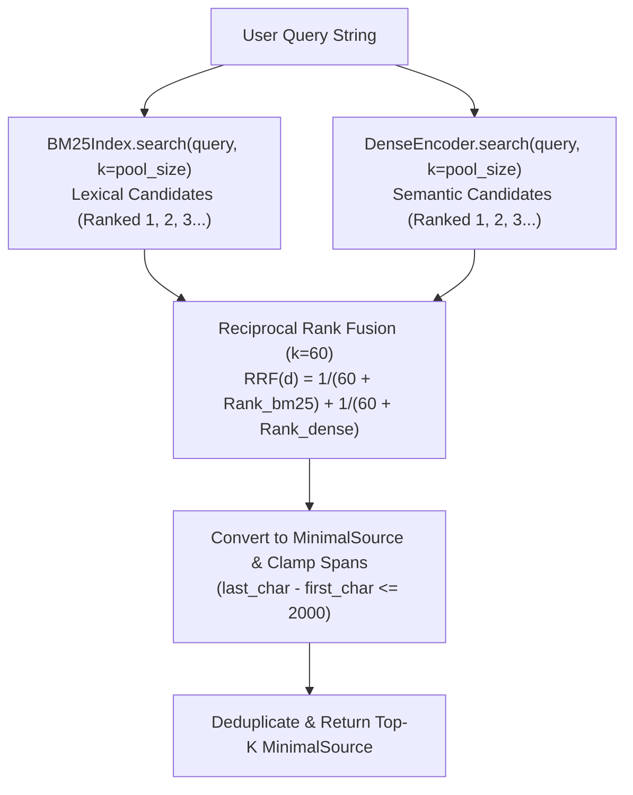
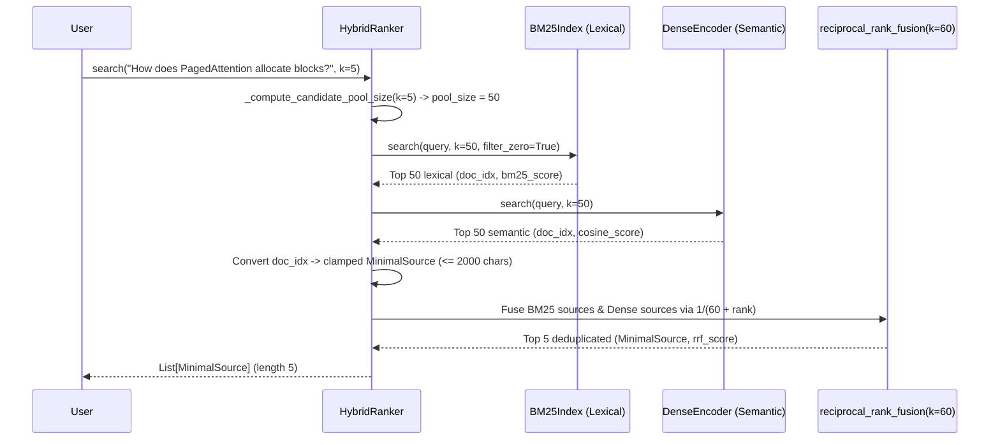

# Beginner's Step-by-Step Guide to Hybrid Retrieval & Reciprocal Rank Fusion (`src/retrieval/hybrid.py`)

This guide explains **what** `src/retrieval/hybrid.py` is, **why** combining BM25 and Dense Retrieval is essential, **why** you cannot simply add their raw scores together, **how** the **Reciprocal Rank Fusion (RRF)** math works (including why $k = 60$), and walks through **every single function, class, and line of code** in `src/retrieval/hybrid.py`.

---

## 1. The Big Picture: What Is `hybrid.py` and What Problem Does It Solve?

In the previous two guides, we built two completely different search engines:
1. **Lexical Search (`src/retrieval/bm25.py`):** Counts exact keyword matches (`BM25Okapi`). Great for exact class names (`AsyncLLMEngine`), CLI flags (`--gpu-memory-utilization`), and error codes, but blind to synonyms.
2. **Dense Semantic Search (`src/retrieval/dense.py`):** Converts text into 384-dimensional meaning vectors (`all-MiniLM-L6-v2`). Great for conceptual questions and synonyms (`"reduce GPU memory"` $\leftrightarrow$ `"lower VRAM footprint"`), but can sometimes blur exact variable names.

### The Million-Dollar Question: How Do We Combine Them?
Suppose a user asks a question, and we run **both** BM25 and Dense Search.
Why can't we just add their scores together (`final_score = bm25_score + dense_score`)?

Because **their scores live on completely incompatible scales!**

| Property | BM25 Score (`bm25.py`) | Dense Cosine Score (`dense.py`) |
| :--- | :--- | :--- |
| **Minimum Possible Score** | `0.0` | `-1.0` |
| **Maximum Possible Score** | **Unbounded!** (`15.0`, `42.8`, `85.0`...) | **Strictly `1.0`** |
| **Depends on Query Length?** | **Yes** — a 12-word query adds 12 IDF terms, producing huge numbers | **No** — unit vectors always have dot product $\le 1.0$ |

Think about what happens if you directly add them (`bm25_score + dense_score`):
- Chunk A has `bm25_score = 32.4` and `dense_score = 0.21`.
- Chunk B has `bm25_score = 29.1` and `dense_score = 0.94`.
- Because BM25 scores are in the `20–40` range while Dense scores are tiny decimals between `0.0` and `1.0`, adding them together means **BM25 completely drowns out Dense Search every single time!** Even trying to normalize them (min-max scaling) breaks down when one outlier document has a huge BM25 spike.

### How `hybrid.py` Solves This: Reciprocal Rank Fusion (RRF)
Introduced by Cormack, Clarke, and Buettcher (SIGIR 2009), **Reciprocal Rank Fusion (RRF)** solves the score incompatibility problem with a brilliantly simple idea:

> **Throw away the raw scores completely, and only look at each document's 1-based RANK position ($1\text{st}, 2\text{nd}, 3\text{rd}, \dots$) in each retriever!**

Whether BM25 gave its #1 result a score of `48.2` or `3.1`, and whether Dense Search gave its #1 result a cosine similarity of `0.92` or `0.65`, **Rank #1 is Rank #1** in both lists!



---

## 2. The Math Behind Reciprocal Rank Fusion (Step-by-Step for Beginners)

### The RRF Formula
For every candidate document (chunk) $d$, its fused RRF score is the sum of its reciprocal rank contributions across our retrieval engines $m \in \{\text{bm25}, \text{dense}\}$:

$$\text{RRF}(d) = \sum_{m \in \{\text{bm25}, \text{dense}\}} \frac{w_m}{k + \text{Rank}_m(d)}$$

Let's translate every piece of this formula into plain English:
- $d$: A specific document chunk.
- $m$: One of our retrieval modalities (`bm25` or `dense`).
- $\text{Rank}_m(d)$: The **1-based position** ($1, 2, 3, \dots$) of chunk $d$ in engine $m$'s result list:
  - Best match = Rank `1`
  - Second best = Rank `2`
  - Tenth best = Rank `10`
  - *(If chunk $d$ did not appear in engine $m$'s candidate list at all, engine $m$ contributes `0.0` to the sum.)*
- $w_m$: An optional weight multiplier for engine $m$ (default is `1.0` for both BM25 and Dense, giving them equal voting power).
- $k$: The **RRF smoothing constant**, set to **`60`** (`DEFAULT_RRF_K = 60`).

When using default weights ($w_{\text{bm25}} = 1.0, w_{\text{dense}} = 1.0$) and $k = 60$, the formula for a chunk $d$ is simply:

$$\text{RRF}(d) = \frac{1}{60 + \text{Rank}_{\text{bm25}}(d)} + \frac{1}{60 + \text{Rank}_{\text{dense}}(d)}$$

---

### Why Do We Add $k = 60$ in the Denominator? (The Secret Behind RRF)

A beginner looking at $\frac{1}{60 + \text{Rank}(d)}$ always asks:
> *"Why do we add `60`? Why not just use $\frac{1}{\text{Rank}(d)}$ (where $k = 0$)?"*

Let's compare what happens **without $k=60$ ($k=0$)** vs. **with $k=60$** on two chunks:
- **Chunk X (Outlier):** Ranked **#1** by BM25 (because it happens to repeat one keyword 20 times), but **completely absent** from Dense Search because its meaning is wrong.
- **Chunk Y (Consensus Winner):** Ranked **#3** by BM25 **AND** ranked **#3** by Dense Search. Both engines agree it is highly relevant!

#### Case A: Without $k$ ($k = 0$, just $\frac{1}{\text{Rank}}$)
- **Chunk X (#1 in BM25 only):**
  $$\text{Score}(X) = \frac{1}{1} + 0 = \mathbf{1.000}$$
- **Chunk Y (#3 in BM25 AND #3 in Dense):**
  $$\text{Score}(Y) = \frac{1}{3} + \frac{1}{3} = \mathbf{0.667}$$
- **Result when $k=0$:** Chunk X (`1.000`) beats Chunk Y (`0.667`)! Because $\frac{1}{1} = 1.0$ is so much larger than $\frac{1}{2} = 0.5$ or $\frac{1}{3} = 0.333$, a single #1 rank in one engine dominates everything—even a document that *both* engines ranked in their top 3!

#### Case B: With $k = 60$ ($\frac{1}{60 + \text{Rank}}$)
Now let's calculate the exact same scenario with $k = 60$:
- **Chunk X (#1 in BM25 only):**
  $$\text{RRF}(X) = \frac{1}{60 + 1} + 0 = \frac{1}{61} \approx \mathbf{0.01639}$$
- **Chunk Y (#3 in BM25 AND #3 in Dense):**
  $$\text{RRF}(Y) = \frac{1}{60 + 3} + \frac{1}{60 + 3} = \frac{1}{63} + \frac{1}{63} \approx 0.01587 + 0.01587 = \mathbf{0.03175}$$
- **Result when $k=60$:** **Chunk Y (`0.03175`) easily beats Chunk X (`0.01639`)!**

> [!IMPORTANT]
> **Key Takeaway for $k = 60$:**
> Adding $k = 60$ flattens the steep drop-off between Rank 1 ($\frac{1}{61} \approx 0.01639$), Rank 2 ($\frac{1}{62} \approx 0.01613$), and Rank 3 ($\frac{1}{63} \approx 0.01587$). As a result, **consensus between both engines is rewarded much more than being #1 in only one engine!**

---

## 3. Worked Hand-Calculated Numerical Example

Suppose a user searches for:
> *"PagedAttention KV cache block allocation"*

We ask BM25 for its top 3 chunks and Dense Search for its top 3 chunks:

| Rank Position ($r$) | BM25 Ranking (`bm25_results`) | Dense Ranking (`dense_results`) | Single-Engine Contribution $\frac{1}{60 + r}$ |
| :---: | :--- | :--- | :---: |
| **Rank 1** | `Chunk 10` *(score: 18.4)* | `Chunk 25` *(score: 0.89)* | $\frac{1}{60 + 1} = \frac{1}{61} \approx \mathbf{0.016393}$ |
| **Rank 2** | `Chunk 42` *(score: 14.1)* | `Chunk 42` *(score: 0.84)* | $\frac{1}{60 + 2} = \frac{1}{62} \approx \mathbf{0.016129}$ |
| **Rank 3** | `Chunk 25` *(score: 9.7)* | `Chunk 99` *(score: 0.78)* | $\frac{1}{60 + 3} = \frac{1}{63} \approx \mathbf{0.015873}$ |

Now let's compute the RRF score for every unique chunk (`Chunk 10`, `Chunk 42`, `Chunk 25`, `Chunk 99`):

1. **`Chunk 42`** (Rank 2 in BM25 + Rank 2 in Dense):
   $$\text{RRF}(\text{Chunk 42}) = \frac{1}{60 + 2} + \frac{1}{60 + 2} = 0.016129 + 0.016129 = \mathbf{0.032258}$$

2. **`Chunk 25`** (Rank 3 in BM25 + Rank 1 in Dense):
   $$\text{RRF}(\text{Chunk 25}) = \frac{1}{60 + 3} + \frac{1}{60 + 1} = 0.015873 + 0.016393 = \mathbf{0.032266}$$

3. **`Chunk 10`** (Rank 1 in BM25 + Not in Dense):
   $$\text{RRF}(\text{Chunk 10}) = \frac{1}{60 + 1} + 0 = \mathbf{0.016393}$$

4. **`Chunk 99`** (Not in BM25 + Rank 3 in Dense):
   $$\text{RRF}(\text{Chunk 99}) = 0 + \frac{1}{60 + 3} = \mathbf{0.015873}$$

### Final Hybrid Ranking (Sorted Highest to Lowest RRF Score):
1. **1st Place: `Chunk 25`** (`0.032266`) — Found by *both* engines (Rank #1 in Dense, Rank #3 in BM25)
2. **2nd Place: `Chunk 42`** (`0.032258`) — Found by *both* engines (Rank #2 in Dense, Rank #2 in BM25)
3. **3rd Place: `Chunk 10`** (`0.016393`) — Found only by BM25 (Rank #1)
4. **4th Place: `Chunk 99`** (`0.015873`) — Found only by Dense (Rank #3)

Notice how `Chunk 25` and `Chunk 42`—which both engines agreed were relevant—rose straight to the top!

---

## 4. Code Walkthrough: `src/retrieval/hybrid.py` Line by Line

Now let's walk through the code in `src/retrieval/hybrid.py` from top to bottom.

---

### Part 1: Module Constants (Lines 33–38)

```python
DEFAULT_RRF_K: int = 60
RRF_K: int = DEFAULT_RRF_K
DEFAULT_MAX_CHUNK_SIZE: int = 2000
DEFAULT_CANDIDATE_MULTIPLIER: int = 4
DEFAULT_MIN_CANDIDATES: int = 50
```

**What each constant controls:**
- `DEFAULT_RRF_K = 60` (`RRF_K`): The standard Reciprocal Rank Fusion constant $k = 60$ from the acceptance criteria.
- `DEFAULT_MAX_CHUNK_SIZE = 2000`: The grading harness requires that every returned `MinimalSource` has `last_character_index - first_character_index <= 2000`.
- `DEFAULT_CANDIDATE_MULTIPLIER = 4` and `DEFAULT_MIN_CANDIDATES = 50`:
  Why don't we just fetch $k = 5$ results from BM25 and $k = 5$ results from Dense when the user asks for the top 5?
  Because what if a great chunk is Ranked **#7** in BM25 and Ranked **#6** in Dense? If we only fetched 5 candidates from each engine, we would miss it in both! By fetching $\max(k, 4k, 50)$ candidates (at least **50 candidates** from each engine) *before* running RRF, chunks ranked #6–#50 in both engines can still combine their scores and jump into the final top 5!

---

### Part 2: `rrf_score` and `clamp_source` (Lines 40–98)

```python
def rrf_score(
    rank: int,
    k: int = DEFAULT_RRF_K,
    weight: float = 1.0,
) -> float:
    if rank < 1:
        raise ValueError(f"rank must be a positive 1-based integer (>= 1), got {rank}")
    if k < 0:
        raise ValueError(f"k must be non-negative (>= 0), got {k}")
    return float(weight) / float(k + rank)
```

- **`rrf_score(rank, k=60, weight=1.0)`:** Computes a single term $\frac{\text{weight}}{k + \text{rank}}$.
- **Why `if rank < 1: raise ValueError`?** In Python, array indices are 0-based (`0, 1, 2...`), whereas RRF math uses **1-based ranks** (`1, 2, 3...`). Checking `rank < 1` catches bugs if someone accidentally passes a 0-based index `0`.

Next, `clamp_source`:

```python
def clamp_source(
    source: MinimalSource,
    max_chunk_size: int = DEFAULT_MAX_CHUNK_SIZE,
) -> MinimalSource:
    if max_chunk_size <= 0:
        raise ValueError(f"max_chunk_size must be positive, got {max_chunk_size}")

    if source.span_length <= max_chunk_size:
        return source

    return MinimalSource(
        file_path=source.file_path,
        first_character_index=source.first_character_index,
        last_character_index=source.first_character_index + max_chunk_size,
    )
```

- **`clamp_source(source, max_chunk_size=2000)`:** Acts as a final safety gate. If `source.span_length` (`last_character_index - first_character_index`) is already $\le 2000$, it returns `source` untouched. If an oversized chunk ever slipped through, it trims `last_character_index` to `first_character_index + 2000` so the evaluation harness never rejects the output.

---

### Part 3: Unwrapping Items, Canonical Keys, and Deduplication (Lines 100–266)

Different callers (or unit tests) may pass ranked items to our hybrid ranker in several formats:
- Raw integer document indices: `[10, 42, 25]`
- `(doc_idx, score)` tuples from `BM25Index.search()` or `DenseEncoder.search()`: `[(10, 18.4), (42, 14.1)]`
- `InternalChunk` objects
- `MinimalSource` objects

To handle all of these seamlessly without crashing, `hybrid.py` uses three small helper functions:

```python
def _is_scored_tuple(item: Any) -> bool:
    """Return True if *item* is a ``(payload, score)`` 2-tuple from a retriever."""
    if not (isinstance(item, tuple) and len(item) == 2):
        return False
    first, second = item
    if isinstance(first, (MinimalSource, InternalChunk, str, int, np.integer)):
        return isinstance(second, (int, float, np.number)) and not isinstance(
            second, bool
        )
    return False


def _unwrap_ranked_item(item: Any) -> Any:
    """Extract the underlying document/chunk/source payload from a ranked item."""
    if _is_scored_tuple(item):
        return item[0]
    return item
```

- **`_unwrap_ranked_item(item)`:** If `item` is a `(payload, score)` tuple like `(42, 14.1)`, it strips off the raw score `14.1` (remember: RRF ignores raw scores!) and returns the payload `42`. Otherwise, it returns `item` as-is.
- *(Note why `not isinstance(second, bool)` is checked in `_is_scored_tuple`: in Python, `bool` is a subclass of `int`, so `isinstance(True, int)` is `True`! We exclude booleans explicitly.)*

Next, `_canonical_item_key(payload)` (lines 119–144):

```python
def _canonical_item_key(payload: Any) -> Any:
    """Return a hashable canonical identity key for a ranked payload."""
    if isinstance(payload, (int, np.integer)):
        return int(payload)
    if isinstance(payload, MinimalSource):
        return (
            payload.file_path,
            payload.first_character_index,
            payload.last_character_index,
        )
    if isinstance(payload, InternalChunk):
        return (
            "chunk",
            payload.chunk_id,
            payload.file_path,
            payload.first_character_index,
            payload.last_character_index,
        )
...
```

- **Why do we need `_canonical_item_key`?**
  To add BM25's score and Dense's score for the *same* document in a Python dictionary `scores_by_key[key]`, we need a hashable dictionary key that uniquely identifies each document:
  - For an integer index (`42`), the key is `42`.
  - For a `MinimalSource`, the key is the 3-tuple `(file_path, first_character_index, last_character_index)`. That way, if two different chunks point to the **exact same file and character span**, RRF automatically recognizes them as the same source, merges their scores, and deduplicates them!

And `to_minimal_source()` (lines 165–227) + `deduplicate_sources()` (lines 230–265):
- **`to_minimal_source(item, chunks, max_chunk_size)`:** Takes *any* candidate representation (an integer index `doc_idx`, a `(doc_idx, score)` tuple, an `InternalChunk`, or a `MinimalSource`), looks up `chunks[doc_idx]` if needed, converts it into a `MinimalSource`, and clamps its character span via `clamp_source()`.
- **`deduplicate_sources(sources, k, max_chunk_size)`:** Iterates through a ranked list of `MinimalSource` objects, keeps a `seen` set of `(file_path, first_character_index, last_character_index)` tuples, skips any duplicates while preserving the exact rank order, and stops once `k` unique sources are collected.

---

### Part 4: `reciprocal_rank_fusion` — The Core RRF Engine (Lines 280–405)

Let's look closely at the core loop inside `reciprocal_rank_fusion()` (lines 362–404):

```python
    scores_by_key: Dict[Any, float] = {}
    payload_by_key: Dict[Any, Any] = {}
    best_rank_by_key: Dict[Any, int] = {}
    first_seen_order: Dict[Any, int] = {}
    order_counter = 0

    for ranking, weight in zip(rankings, modality_weights):
        if weight == 0.0:
            continue
        seen_in_modality: Set[Any] = set()
        for idx, raw_item in enumerate(ranking):
            rank = idx + 1  # 1-based rank
            payload = _normalize_payload(_unwrap_ranked_item(raw_item))
            key = _canonical_item_key(payload)

            if key in seen_in_modality:
                continue
            seen_in_modality.add(key)

            contribution = rrf_score(rank=rank, k=effective_rrf_k, weight=weight)
            scores_by_key[key] = scores_by_key.get(key, 0.0) + contribution

            if key not in payload_by_key:
                payload_by_key[key] = payload
                first_seen_order[key] = order_counter
                order_counter += 1

            if key not in best_rank_by_key or rank < best_rank_by_key[key]:
                best_rank_by_key[key] = rank
```

**Step-by-step trace of what happens inside this loop:**
1. **`rank = idx + 1`:** Converts Python's 0-based `enumerate` index (`0, 1, 2...`) into the 1-based RRF rank (`1, 2, 3...`).
2. **`seen_in_modality` (Per-Engine Deduplication Guard):**
   What if a single retriever accidentally returned the same document twice in its own list (e.g., at rank 1 and rank 4)? A single retriever shouldn't get to vote twice for the same document! `if key in seen_in_modality: continue` ensures each retriever contributes at most once per unique document (at its highest/best rank).
3. **`contribution = rrf_score(rank=rank, k=effective_rrf_k, weight=weight)`:**
   Calculates $\frac{w_m}{60 + \text{rank}}$ and adds it to `scores_by_key[key]`.
   - If `key` was only in BM25, `scores_by_key[key]` has 1 term.
   - If `key` was in **both** BM25 and Dense, `scores_by_key[key]` automatically accumulates the sum of **both** terms!

Now look at how the fused results are sorted (lines 392–404):

```python
    sorted_keys = sorted(
        scores_by_key.keys(),
        key=lambda key: (
            -scores_by_key[key],
            best_rank_by_key[key],
            first_seen_order[key],
        ),
    )
```

**Why does the sort key have 3 parts `(-scores_by_key[key], best_rank_by_key[key], first_seen_order[key])`?**
This provides **100% deterministic tie-breaking**:
1. **Primary sort (`-scores_by_key[key]`):** Highest RRF score comes first.
2. **First tie-breaker (`best_rank_by_key[key]`):** Suppose Chunk A is Rank #1 in BM25 only ($\frac{1}{61}$) and Chunk B is Rank #1 in Dense only ($\frac{1}{61}$), or suppose two combinations yield the exact same floating-point sum. The chunk that achieved the better (smaller) individual rank wins.
3. **Second tie-breaker (`first_seen_order[key]`):** If both score and best rank are identical (e.g., Rank #1 in BM25 vs. Rank #1 in Dense), the item encountered first (`bm25_results` before `dense_results`) wins deterministically.

---

### Part 5: `fuse_sources` — Fusing Directly into `MinimalSource` Objects (Lines 407–474)

```python
def fuse_sources(
    bm25_results: Sequence[Any],
    dense_results: Optional[Sequence[Any]] = None,
    k: Optional[int] = None,
    *,
    rrf_k: int = DEFAULT_RRF_K,
    chunks: Optional[Sequence[Any]] = None,
...
) -> List[MinimalSource]:
    if k is not None and k <= 0:
        return []

    lexical_lookup = bm25_chunks if bm25_chunks is not None else chunks
    semantic_lookup = dense_chunks if dense_chunks is not None else chunks

    bm25_sources: List[MinimalSource] = [
        to_minimal_source(item, chunks=lexical_lookup, max_chunk_size=max_chunk_size)
        for item in bm25_results
    ]

    dense_sources: Optional[List[MinimalSource]] = None
    if dense_results is not None:
        dense_sources = [
            to_minimal_source(
                item, chunks=semantic_lookup, max_chunk_size=max_chunk_size
            )
            for item in dense_results
        ]

    fused = reciprocal_rank_fusion(
        bm25_results=bm25_sources,
        dense_results=dense_sources,
        k=rrf_k,
        top_k=k,
        bm25_weight=bm25_weight,
        dense_weight=dense_weight,
    )

    return [src for src, _ in fused]
```

**Why do we convert items to `MinimalSource` *before* calling `reciprocal_rank_fusion`?**
Imagine two different `chunk_id`s somehow pointed to the exact same `(file_path, first_character_index, last_character_index)` span. By converting every candidate into a clamped `MinimalSource` *first*, `reciprocal_rank_fusion` uses `(file_path, first_character_index, last_character_index)` as the dictionary key—meaning it both **merges their RRF scores** and **guarantees zero duplicate `MinimalSource` spans** in the final top-$k$ list!

---

### Part 6: The `HybridRanker` Class (Lines 476–904)

`HybridRanker` (also aliased as `HybridRetriever`, `RRFHybridRanker`, and `HybridSearchEngine`) is the high-level orchestrator that holds a `BM25Index` and a `DenseEncoder` and runs end-to-end hybrid search for any query string.

#### 1. Initialization & Automatic Chunk Discovery (`__init__` & `_discover_chunks`, Lines 487–568)
When you create `ranker = HybridRanker(bm25_index=bm25, dense_encoder=dense)`, you don't even have to pass `chunks` manually! `_discover_chunks()` automatically inspects `dense_encoder.chunks` and `bm25_index.chunks` and attaches the `InternalChunk` metadata list.

#### 2. Candidate Pool Sizing (`_compute_candidate_pool_size`, Lines 570–578)
```python
    def _compute_candidate_pool_size(
        self,
        k: int,
        candidate_k: Optional[int] = None,
    ) -> int:
        """Determine how many candidates to fetch from each sub-retriever."""
        if candidate_k is not None:
            return max(k, int(candidate_k))
        return max(k, k * self.candidate_multiplier, self.min_candidates)
```
When the caller asks for `k = 5` final results, `_compute_candidate_pool_size(5)` returns $\max(5, 5 \times 4, 50) = 50$. Both BM25 and Dense retrieve their top 50 candidates so RRF has a rich pool of candidates to intersect.

#### 3. Fault-Tolerant Sub-Retriever Calls (`_retrieve_bm25_candidates` & `_retrieve_dense_candidates`, Lines 580–607)
```python
    def _retrieve_bm25_candidates(
        self,
        query: str,
        pool_size: int,
    ) -> List[Tuple[int, float]]:
        if self.bm25_index is None or self.bm25_index.num_docs == 0:
            return []
        try:
            return self.bm25_index.search(query, k=pool_size, filter_zero=True)
        except Exception as exc:
            logger.warning("BM25 retrieval failed for query '%s': %s", query, exc)
            return []
```
Notice two critical design choices here:
- **`filter_zero=True` on BM25:** In BM25, if a chunk shares **zero** tokens with the query, its score is `0.0`. We must **not** give a `0.0`-score chunk an RRF rank! Setting `filter_zero=True` ensures only chunks with actual keyword matches get ranked by BM25.
- **Graceful Degradation (`try ... except`):** If one engine is missing (`None`) or raises an unexpected runtime error, `HybridRanker` logs a warning and gracefully falls back to the other engine rather than crashing the pipeline.

#### 4. The Public Search Methods (Lines 616–899)
`HybridRanker` provides a rich set of methods so every downstream caller (CLI, evaluation script, RAG generator) gets the exact return type it needs:

| Method | Return Type | When to Use It |
| :--- | :--- | :--- |
| `ranker.search(query, k=5)` / `ranker.search_sources(query, k=5)` / `ranker(query, k=5)` | `List[MinimalSource]` | **Primary production API** — returns top-$k$ deduplicated, span-clamped `MinimalSource` objects ready for Moulinette evaluation and LLM prompt context |
| `ranker.search_with_scores(query, k=5)` | `List[Tuple[int, float]]` | Returns `(doc_idx, rrf_score)` pairs when you want to inspect the numerical RRF scores |
| `ranker.get_top_k(query, k=5)` | `List[int]` | Returns just the top-$k$ integer `chunk_id`s |
| `ranker.get_scores(query)` | `Dict[int, float]` | Returns a dictionary mapping `doc_idx -> rrf_score` across all matched candidates |
| `ranker.fuse(bm25_res, dense_res, k=5)` / `ranker.rank(...)` | `List[MinimalSource]` | Fuses **already-retrieved** lists from BM25 and Dense into `MinimalSource` objects without re-running the engines |
| `ranker.fuse_rankings(bm25_res, dense_res, top_k=5)` | `List[Tuple[Any, float]]` | Fuses **already-retrieved** lists and returns `(item, rrf_score)` pairs |

---

## 5. End-to-End Summary Diagram


