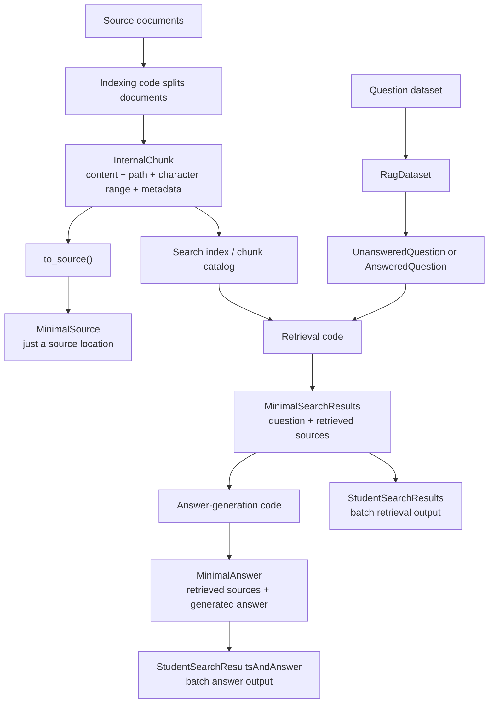
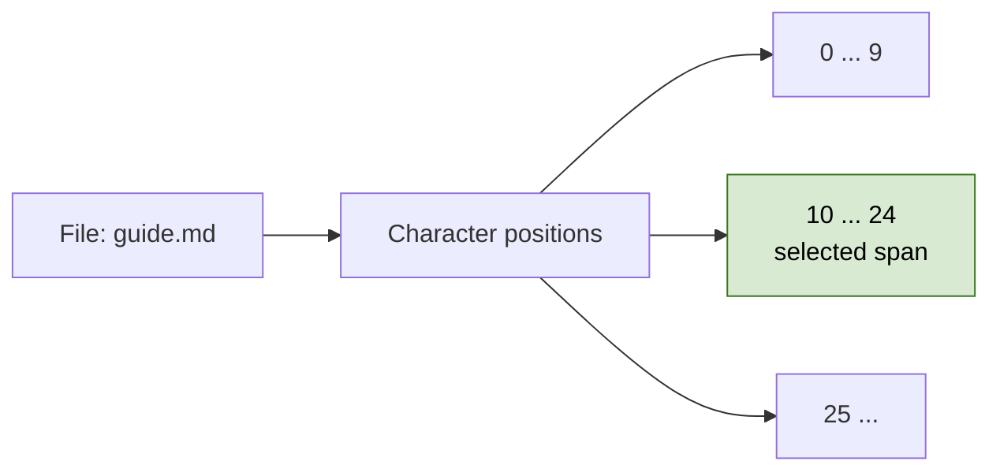
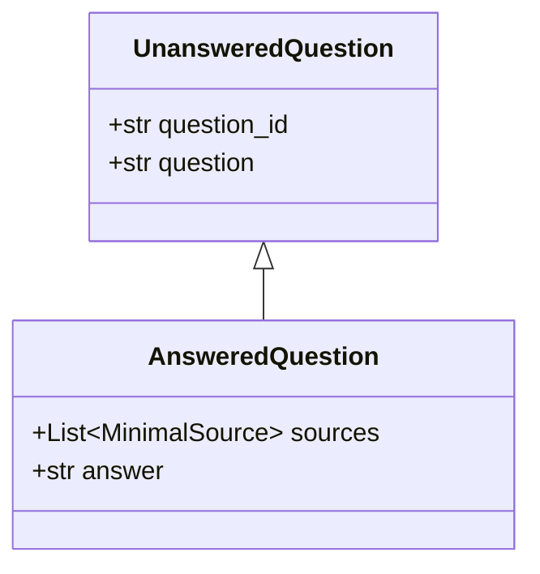
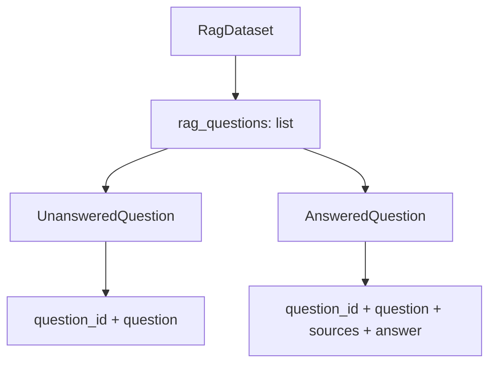
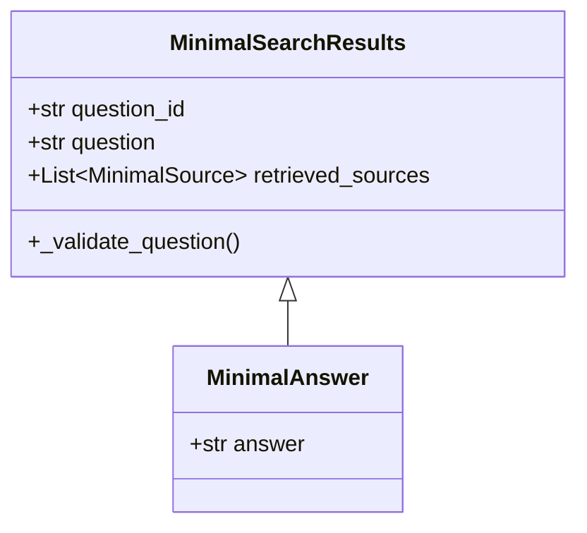
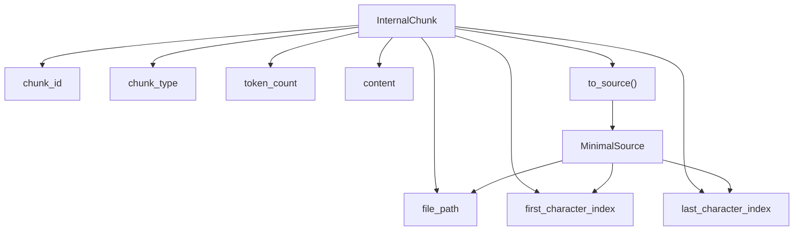
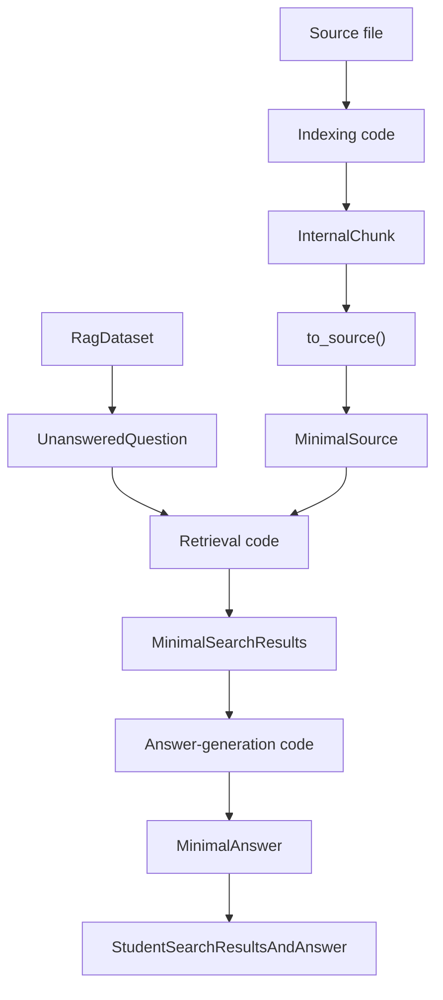

# RAG Project Models and Indexing Schemas

This document explains the Pydantic models, their fields, validators, properties, helper methods, decorators, and how they fit together in a Retrieval-Augmented Generation (RAG) pipeline.

> **Scope:** This guide documents the code shown in this conversation: `src.models` and the internal indexing schema containing `ChunkType` and `InternalChunk`. If your project has additional classes or functions, add them as they are reviewed.

## Contents

1. [Big picture: where the models fit](#1-big-picture-where-the-models-fit)
2. [Shared concepts and syntax](#2-shared-concepts-and-syntax)
3. [`normalize_file_path()`](#3-normalize_file_path)
4. [`MinimalSource`](#4-minimalsource)
5. [`UnansweredQuestion`](#5-unansweredquestion)
6. [`AnsweredQuestion`](#6-answeredquestion)
7. [`RagDataset`](#7-ragdataset)
8. [`MinimalSearchResults`](#8-minimalsearchresults)
9. [`MinimalAnswer`](#9-minimalanswer)
10. [`StudentSearchResults`](#10-studentsearchresults)
11. [`StudentSearchResultsAndAnswer`](#11-studentsearchresultsandanswer)
12. [`ChunkType`](#12-chunktype)
13. [`InternalChunk`](#13-internalchunk)
14. [`__all__`](#14-__all__)
15. [End-to-end example](#15-end-to-end-example)
16. [Quick reference tables](#16-quick-reference-tables)

---

## 1. Big picture: where the models fit

A RAG application typically has two main phases:

- **Indexing:** read documents, split them into chunks, and store information that helps retrieve those chunks later.
- **Question answering:** take a question, retrieve relevant chunks, and use them to produce an answer.

These classes mostly define **the shape and validation rules of data** moving between those phases. A Pydantic model does not automatically read files, perform a search, count tokens, or generate an answer unless code explicitly tells it to do so.



The diagram is conceptual. The exact order and storage mechanism depend on the rest of the application.

### The main distinction

| Model | Main purpose |
|---|---|
| `InternalChunk` | Full internal record for one indexed text chunk |
| `MinimalSource` | Lightweight reference to a location in a source file |
| `UnansweredQuestion` | Question waiting to be answered |
| `AnsweredQuestion` | Question with a reference answer and optional reference sources |
| `RagDataset` | Collection of answered and/or unanswered questions |
| `MinimalSearchResults` | One question and the sources retrieved for it |
| `MinimalAnswer` | One question, retrieved sources, and a generated answer |
| `StudentSearchResults` | Batch of retrieval results |
| `StudentSearchResultsAndAnswer` | Batch of retrieval results that also include answers |

---

## 2. Shared concepts and syntax

The models use Pydantic. Pydantic checks incoming data against the declared fields and rules when a model is created.

### `BaseModel`

```python
class Example(BaseModel):
    name: str
```

Inheriting from `BaseModel` makes `Example` a Pydantic model. Creating `Example(name="Ada")` produces a validated object rather than just an unstructured dictionary.

### `Field(...)`

`Field()` configures a model field.

```python
question: str = Field(..., min_length=1, description="Question text")
```

- `...` means the field is required.
- `min_length=1` rejects an empty string.
- `description` documents the field and can be used in generated schemas.
- A field's type, such as `str` or `int`, also influences validation.

### `Field(default_factory=...)`

```python
question_id: str = Field(default_factory=lambda: str(uuid.uuid4()))
```

A `default_factory` function is called when a value is not supplied. Here, it creates a new UUID string for the question ID. It avoids reusing one precomputed default value.

### `ConfigDict(frozen=True, extra="ignore")`

```python
model_config = ConfigDict(frozen=True, extra="ignore")
```

- `frozen=True`: prevents normal reassignment of model fields after creation.
- `extra="ignore"`: ignores unexpected input fields instead of storing them or rejecting them.

**Important:** `frozen=True` is not a guarantee of deep immutability. For example, a list stored in a frozen model may still be mutable through list operations.

### `@field_validator(...)`

A field validator adds custom validation or cleanup for a particular field.

```python
@field_validator("file_path", mode="before")
@classmethod
def _validate_file_path(cls, v: Any) -> str:
    return normalize_file_path(v)
```

- `@field_validator("file_path")` tells Pydantic which field to validate.
- `mode="before"` means the validator runs before Pydantic's usual validation for that field. It can therefore normalize or convert the raw input.
- `@classmethod` makes the validator a class method, with the model class passed as `cls`.
- `v` is the incoming value.
- The returned value is passed on for further validation.

Without `mode="before"`, a field validator normally runs after Pydantic has validated/coerced the field's basic type.

### `@model_validator(mode="after")`

A model validator checks a relationship between fields after the model has been validated and constructed.

```python
@model_validator(mode="after")
def _validate_character_spans(self) -> Self:
    if self.last_character_index <= self.first_character_index:
        raise ValueError("Invalid character range")
    return self
```

This is useful when a rule depends on multiple fields. The starting index and ending index can each be valid integers individually while still forming an invalid range together.

- `mode="after"` runs after field validation.
- `self` is the model instance.
- `Self` means the same class as the method's enclosing class.
- Raising `ValueError` tells Pydantic that validation failed.
- Returning `self` means validation succeeded.

### `@property`

A property allows a method to be accessed like an attribute.

```python
@property
def span_length(self) -> int:
    return self.last_character_index - self.first_character_index
```

Use `chunk.span_length`, not `chunk.span_length()`. The property calculates a value when accessed; it does not store a separate field.

### `Literal[...]`

```python
ChunkType = Literal[
    "python_class",
    "python_func",
    "python_module",
    "markdown_section",
]
```

`Literal` restricts a value to the listed options. It is useful when a field should accept one of a fixed set of categories.

### `Union[...]` and `List[...]`

- `List[MinimalSource]` means a list of `MinimalSource` objects.
- `Union[A, B]` means a value may be of type `A` or type `B`.
- `List[Union[A, B]]` means a list whose elements may each be either type.

In modern Python, similar annotations can be written using `list[...]` and `A | B`, but the code here uses `List` and `Union`.

### `Any`

`Any` means the incoming value may be of any type. In the path validator, this is useful because `normalize_file_path()` accepts a string or a `Path` and is intended to normalize the raw input before final field validation.

### `__future__.annotations` and `Self`

```python
from __future__ import annotations
from typing_extensions import Self
```

- `from __future__ import annotations` postpones evaluation of type annotations, which can help with forward references.
- `Self` describes a method that returns an instance of its own class. Here, the model validator returns `self` after successful validation.

---

## 3. `normalize_file_path()`

### What it does

`normalize_file_path(path: Union[str, Path]) -> str` standardizes a file path so that different spellings of the same path are more consistent.

The version discussed in this project:
1. Removes surrounding whitespace.
2. Replaces Windows-style backslashes (`\\`) with forward slashes (`/`).
3. Looks for the `data/raw/` marker and uses that as a useful relative-path anchor when present.
4. Otherwise, attempts to make an absolute path relative to the current working directory.
5. Removes leading `./` and `/` where appropriate.
6. Applies `posixpath.normpath()` to normalize `.` and `..` path components.
7. Rejects an empty or `.` result.
8. Returns a normalized string.

### Example

```python
normalize_file_path(r"data\raw\docs\guide.md")
# Example result: "data/raw/docs/guide.md"
```

The exact result for absolute paths depends on the function's implementation and the current working directory.

### Why it is used

The same file could otherwise be represented with different slash styles or redundant path segments. Consistent paths make it easier to compare and store source locations.

**Caution:** path normalization is not automatically a complete security check. If the application needs to guarantee that a path stays inside a trusted directory, it should explicitly check containment after resolving the path.

---

## 4. `MinimalSource`

### What it represents

`MinimalSource` is a small pointer to a specific range of characters in a file. It records **where** a source passage is located, not the passage's text itself.

### Fields and behavior

| Component | What it does |
|---|---|
| `file_path` | Required path to the source file, normalized by `_validate_file_path()` |
| `first_character_index` | Required integer at least `0`; inclusive start position |
| `last_character_index` | Required integer greater than `0`; exclusive end position |
| `_validate_file_path()` | Runs `normalize_file_path()` before normal field validation |
| `_validate_character_spans()` | Ensures the end index is greater than the start index |
| `span_length` | Calculates `last_character_index - first_character_index` |
| `model_config` | Freezes normal field reassignment and ignores extra input fields |

The character range uses the common Python slicing convention: the start is included and the end is excluded.

### Example

```python
source = MinimalSource(
    file_path="data/raw/docs/guide.md",
    first_character_index=10,
    last_character_index=25,
)

print(source.span_length)  # 15
```

The location represents characters at positions `10` through `24`, a total of `15` characters.



### Validation example

```python
MinimalSource(
    file_path="data/raw/docs/guide.md",
    first_character_index=25,
    last_character_index=10,
)
```

This fails because `last_character_index` is not greater than `first_character_index`.

---

## 5. `UnansweredQuestion`

### What it represents

`UnansweredQuestion` stores a question that can be passed into a retrieval and answer-generation pipeline. It does not contain a reference answer.

### Fields and behavior

| Component | What it does |
|---|---|
| `question_id` | Unique ID; generated automatically if omitted |
| `question` | Required question text with at least one character |
| `default_factory=lambda: str(uuid.uuid4())` | Creates a fresh UUID string for each missing ID |
| `Field(..., min_length=1)` | Makes `question` required and rejects an empty string |
| `model_config` | Freezes normal field reassignment and ignores extra fields |

### Example

```python
question = UnansweredQuestion(
    question="What is retrieval-augmented generation?"
)

print(question.question)
print(question.question_id)  # Generated UUID string
```

Because `question_id` has a default factory, you do not have to supply it. If you do not provide an ID, each new instance gets its own generated value.

**Note:** `min_length=1` rejects `""`, but a string containing only spaces may still pass this model's declared rule. `MinimalSearchResults` has an additional validator that strips and rejects whitespace-only questions.

---

## 6. `AnsweredQuestion`

### What it represents

`AnsweredQuestion` extends `UnansweredQuestion` with a reference answer and optional reference-source locations. It is useful when a dataset contains expected answers for testing or evaluating a RAG system.

### Inheritance diagram



### Fields and behavior

| Component | What it does |
|---|---|
| Inherited `question_id` | Unique question ID, generated if omitted |
| Inherited `question` | Required question text |
| `sources` | List of reference `MinimalSource` locations; defaults to an empty list |
| `answer` | Required ground-truth/reference answer |
| `default_factory=list` | Creates a fresh empty list when `sources` is omitted |

### Example

```python
expected = AnsweredQuestion(
    question="Where is the configuration documented?",
    sources=[
        MinimalSource(
            file_path="data/raw/docs/config.md",
            first_character_index=100,
            last_character_index=160,
        )
    ],
    answer="The configuration is documented in config.md.",
)
```

Here, `answer` is the expected answer used as a reference. It is not generated automatically by the model.

---

## 7. `RagDataset`

### What it represents

`RagDataset` is a container for a collection of RAG questions. Each entry may be an `AnsweredQuestion` or an `UnansweredQuestion`.

### Field

| Component | What it does |
|---|---|
| `rag_questions` | List of question objects; defaults to an empty list |
| `List[Union[AnsweredQuestion, UnansweredQuestion]]` | Permits either question type in the list |
| `default_factory=list` | Creates an empty list if no questions are supplied |

### Example

```python
dataset = RagDataset(
    rag_questions=[
        UnansweredQuestion(question="What is a chunk?"),
        AnsweredQuestion(
            question="What is RAG?",
            answer="RAG combines retrieval with answer generation.",
        ),
    ]
)

print(len(dataset.rag_questions))  # 2
```

### Relationship diagram



**Implementation note:** because `AnsweredQuestion` inherits from `UnansweredQuestion`, the precise way dictionaries are parsed into a `Union` can depend on Pydantic's version and union-matching behavior. If preserving the distinction between answered and unanswered dictionary inputs is important, test parsing with the project's installed Pydantic version; a discriminated union can make the choice explicit.

---

## 8. `MinimalSearchResults`

### What it represents

`MinimalSearchResults` records the retrieval output for **one question**: the question's ID and text, plus the source locations found by the search stage.

It stores results; it does not perform the search itself.

### Fields and behavior

| Component | What it does |
|---|---|
| `question_id` | Unique ID, generated if omitted |
| `question` | Required question text |
| `retrieved_sources` | List of candidate `MinimalSource` locations; defaults to an empty list |
| `_validate_question()` | Strips leading/trailing whitespace and rejects an empty or whitespace-only result |
| `@field_validator("question")` | Registers `_validate_question()` as the question field validator |
| `@classmethod` | Defines the validator as a class method |
| `model_config` | Freezes normal field reassignment and ignores extra fields |

The `@field_validator("question")` shown in this class does not specify `mode="before"`, so Pydantic's default field-validator mode is `after`. The function receives the validated string, strips its ends, then returns the cleaned string.

### Example

```python
results = MinimalSearchResults(
    question="  How does indexing work?  ",
    retrieved_sources=[
        MinimalSource(
            file_path="data/raw/docs/indexing.md",
            first_character_index=40,
            last_character_index=90,
        )
    ],
)

print(results.question)  # "How does indexing work?"
print(len(results.retrieved_sources))  # 1
```

### Ground-truth sources vs retrieved sources

| Name | Meaning |
|---|---|
| `AnsweredQuestion.sources` | Reference source locations associated with the expected answer |
| `MinimalSearchResults.retrieved_sources` | Candidate locations found by the retrieval system |

The retrieved sources may or may not match the reference sources.

---

## 9. `MinimalAnswer`

### What it represents

`MinimalAnswer` extends `MinimalSearchResults` with a generated natural-language answer. It represents the result for one question after retrieval and answer generation.

### Inheritance diagram



### Fields and behavior

| Component | What it does |
|---|---|
| Inherited `question_id` | Question identifier |
| Inherited `question` | Cleaned question text |
| Inherited `retrieved_sources` | Candidate source locations returned by retrieval |
| `answer` | Required generated answer text |

### Example

```python
answer_result = MinimalAnswer(
    question="What does the index store?",
    retrieved_sources=[
        MinimalSource(
            file_path="data/raw/docs/indexing.md",
            first_character_index=0,
            last_character_index=70,
        )
    ],
    answer="The index stores information used to find relevant chunks.",
)
```

The model validates and stores the supplied answer. It does not generate that answer by itself.

---

## 10. `StudentSearchResults`

### What it represents

`StudentSearchResults` is a batch output format for retrieval-only results. The docstring says it is an official batch search output evaluated by the `moulinette` (an automated evaluation/grading process in this project).

### Fields and behavior

| Component | What it does |
|---|---|
| `search_results` | List of `MinimalSearchResults`; defaults to an empty list |
| `k` | Required integer greater than or equal to `1` |
| `Field(..., ge=1)` | Rejects `k` values below `1` |
| `model_config` | Freezes normal field reassignment and ignores extra fields |

In retrieval systems, `k` commonly means the requested number of candidate sources per question. This model checks only that `k >= 1`; it does **not** enforce that every result actually contains exactly `k` sources.

### Example

```python
batch = StudentSearchResults(
    search_results=[
        MinimalSearchResults(
            question="What is indexing?",
            retrieved_sources=[],
        ),
        MinimalSearchResults(
            question="What is retrieval?",
            retrieved_sources=[],
        ),
    ],
    k=3,
)
```

This says the batch was configured to retrieve up to three candidate sources per question. The empty lists in this example are just placeholders; the model itself does not retrieve the sources.

---

## 11. `StudentSearchResultsAndAnswer`

### What it represents

`StudentSearchResultsAndAnswer` is a batch output format for results that include both retrieved sources and generated answers.

### Fields and behavior

| Component | What it does |
|---|---|
| `search_results` | List of `MinimalAnswer` objects; defaults to an empty list |
| `k` | Required integer at least `1` |
| `Field(..., ge=1)` | Validates the minimum value of `k` |
| `model_config` | Freezes normal field reassignment and ignores extra fields |

### Example

```python
batch_with_answers = StudentSearchResultsAndAnswer(
    search_results=[
        MinimalAnswer(
            question="What is a chunk?",
            retrieved_sources=[],
            answer="A chunk is a smaller piece of a source document.",
        )
    ],
    k=3,
)
```

Use this model when each item in the batch must include an answer. Use `StudentSearchResults` when the output contains retrieval results only.

---

## 12. `ChunkType`

### What it represents

`ChunkType` is a type alias that restricts a chunk's category to one of four literal strings.

```python
ChunkType = Literal[
    "python_class",
    "python_func",
    "python_module",
    "markdown_section",
]
```

| Allowed value | Meaning |
|---|---|
| `"python_class"` | A Python class definition |
| `"python_func"` | A Python function definition |
| `"python_module"` | A Python module or file-level chunk |
| `"markdown_section"` | A section of a Markdown document |

For example, `chunk_type="markdown_section"` is allowed, while `chunk_type="spreadsheet"` is not.

`Literal` provides the restriction; it does not detect the type of a chunk from its content. Indexing code must choose the appropriate category.

---

## 13. `InternalChunk`

### What it represents

`InternalChunk` is the full internal record for one piece of a source file that has been selected for indexing. Unlike `MinimalSource`, it stores the actual chunk text and indexing metadata as well as its source location.

### Fields and behavior

| Component | What it does |
|---|---|
| `chunk_id` | Required integer `>= 0`; identifies a chunk in the indexing system |
| `file_path` | Required path to the original file; normalized by `_validate_file_path()` |
| `first_character_index` | Required inclusive start position, `>= 0` |
| `last_character_index` | Required exclusive end position, `> 0` |
| `chunk_type` | Required `ChunkType` category |
| `token_count` | Required integer `>= 0`; stores the token count supplied by indexing code |
| `content` | Required string containing the chunk's actual text |
| `_validate_file_path()` | Normalizes the path before normal field validation |
| `_validate_character_spans()` | Checks that `last_character_index > first_character_index` |
| `span_length` | Returns `last_character_index - first_character_index` |
| `to_source()` | Builds a `MinimalSource` containing only the file path and character range |
| `model_config` | Freezes normal field reassignment and ignores extra input fields |

### Important details

- `chunk_id` is described as sequential, but this model only checks that it is non-negative. It does not check uniqueness or sequence across multiple chunks.
- `token_count` is supplied by other code. The model does not tokenize `content` or calculate the count.
- `content` is required, but the shown field definition does not explicitly reject an empty string.
- The character range is validated for ordering, but the model does not check that the end position is within the actual file length.
- `to_source()` returns a new, simpler `MinimalSource`. It leaves out `chunk_id`, `chunk_type`, `token_count`, and `content`.

### Example

```python
chunk = InternalChunk(
    chunk_id=0,
    file_path="data/raw/docs/rag.md",
    first_character_index=100,
    last_character_index=150,
    chunk_type="markdown_section",
    token_count=12,
    content="RAG retrieves relevant information.",
)

print(chunk.span_length)  # 50

source = chunk.to_source()
print(source.file_path)              # "data/raw/docs/rag.md"
print(source.first_character_index)  # 100
print(source.last_character_index)   # 150
```

### How `InternalChunk` becomes `MinimalSource`



The `MinimalSource` is a location reference. The full `InternalChunk` is the record that also knows the text and its indexing metadata.

---

## 14. `__all__`

`__all__` is a module-level list of names intended to be exposed when someone uses a wildcard import.

For the internal chunk schema:

```python
__all__ = [
    "ChunkType",
    "InternalChunk",
]
```

For the models module, the list includes:

```python
__all__ = [
    "MinimalSource",
    "UnansweredQuestion",
    "AnsweredQuestion",
    "RagDataset",
    "MinimalSearchResults",
    "MinimalAnswer",
    "StudentSearchResults",
    "StudentSearchResultsAndAnswer",
    "normalize_file_path",
]
```

For example:

```python
from src.models import *
```

Python uses `__all__` to decide which names from that module are imported by `*`. It does not prevent a caller from explicitly importing another name that exists in the module.

---

## 15. End-to-end example

This example illustrates how the model objects can represent data as it moves through a simplified RAG workflow. It does not implement retrieval or generation.

### Step 1: define a question dataset

```python
dataset = RagDataset(
    rag_questions=[
        UnansweredQuestion(
            question="What is stored in a chunk?"
        )
    ]
)
```

### Step 2: represent a chunk found during indexing

```python
chunk = InternalChunk(
    chunk_id=0,
    file_path="data/raw/docs/indexing.md",
    first_character_index=0,
    last_character_index=45,
    chunk_type="markdown_section",
    token_count=9,
    content="A chunk is a piece of a source document.",
)
```

### Step 3: create a lightweight reference to that chunk

```python
source = chunk.to_source()
```

The reference contains the path and character span, but not the text or token count.

### Step 4: represent retrieval output

```python
retrieval_result = MinimalSearchResults(
    question=dataset.rag_questions[0].question,
    retrieved_sources=[source],
)
```

This object represents the output you would create **after** retrieval code has selected the source.

### Step 5: represent an answer

```python
answer_result = MinimalAnswer(
    question=retrieval_result.question,
    question_id=retrieval_result.question_id,
    retrieved_sources=retrieval_result.retrieved_sources,
    answer="A chunk is a piece of a source document.",
)
```

The answer text is supplied here as an example. A model does not call an LLM automatically.

### Step 6: wrap the result in a batch output

```python
submission = StudentSearchResultsAndAnswer(
    search_results=[answer_result],
    k=1,
)
```

### End-to-end flow diagram



**Remember:** the models describe and validate the information. Other parts of the application perform the real work: reading files, splitting chunks, counting tokens, searching an index, and generating answers.

---

## 16. Quick reference tables

### Model overview

| Component | What it does |
|---|---|
| `normalize_file_path()` | Standardizes a file path string |
| `MinimalSource` | Identifies a file and a character range |
| `UnansweredQuestion` | Stores a question without a reference answer |
| `AnsweredQuestion` | Stores a question, reference answer, and optional reference sources |
| `RagDataset` | Holds a list of question objects |
| `MinimalSearchResults` | Stores one question and its retrieved source locations |
| `MinimalAnswer` | Stores one question, retrieved sources, and a generated answer |
| `StudentSearchResults` | Batch retrieval-output model |
| `StudentSearchResultsAndAnswer` | Batch output model including answers |
| `ChunkType` | Limits chunk categories to four permitted strings |
| `InternalChunk` | Stores chunk text, location, type, and indexing metadata |
| `__all__` | Defines names included in wildcard imports |

### Decorators and validation syntax

| Syntax | Meaning |
|---|---|
| `@field_validator("field")` | Adds validation or cleanup for one field |
| `mode="before"` | Run the field validator before ordinary field validation |
| `@model_validator(mode="after")` | Validate rules involving the completed model and multiple fields |
| `@classmethod` | Defines a method that receives the class as its first argument |
| `@property` | Lets a method be accessed as an attribute |
| `Field(...)` | Declares a required field and/or its validation rules |
| `default_factory=list` | Creates a fresh empty list when no value is supplied |
| `default_factory=lambda: ...` | Calls a function to generate a default value |
| `ConfigDict(frozen=True, extra="ignore")` | Prevents ordinary field reassignment and ignores unexpected input fields |
| `Literal[...]` | Restricts a value to a fixed set of literal options |
| `List[...]` | Declares a list with a specified item type |
| `Union[A, B]` | Allows either type `A` or type `B` |
| `@property` + `span_length` | Calculates the range length on access |
| `to_source()` | Converts a full internal chunk record into a lightweight source reference |

### Which output model should I use?

| If you need to represent... | Use |
|---|---|
| One source location | `MinimalSource` |
| One question without an expected answer | `UnansweredQuestion` |
| One question with a reference answer | `AnsweredQuestion` |
| A collection of questions | `RagDataset` |
| One question's retrieved sources | `MinimalSearchResults` |
| One question's retrieved sources and generated answer | `MinimalAnswer` |
| A batch of retrieval results | `StudentSearchResults` |
| A batch of retrieval results and answers | `StudentSearchResultsAndAnswer` |
| One complete internal indexed chunk | `InternalChunk` |

---

## Final takeaway

Think of the classes as **data contracts**:

- `InternalChunk` carries the full information about an indexed text piece.
- `MinimalSource` points to where a passage lives.
- Question models represent input questions and, where applicable, reference answers.
- Search-result models represent what retrieval found.
- Answer models represent generated answers.
- Batch models package many results into the expected output format.
- Validators catch invalid values or clean inputs before those objects are used elsewhere.
