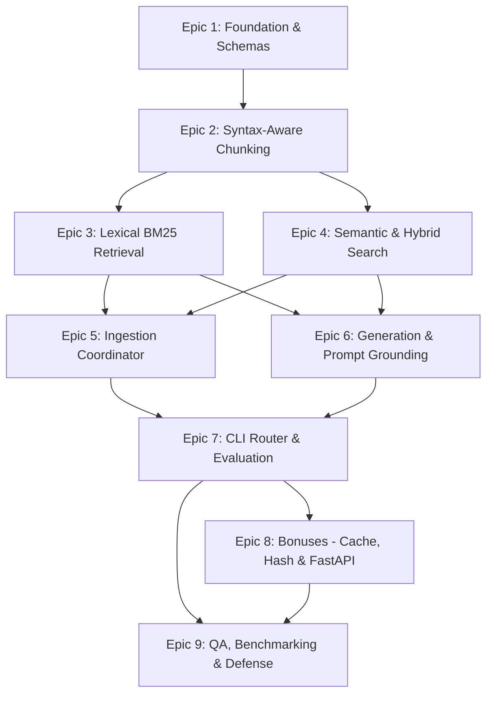

# Engineering Tickets: RAG Against the Machine (v2.0)

**Project:** RAG Against the Machine — Codebase Question Answering System  
**Reference Corpus:** `vLLM v0.10.1`  
**Evaluation Standard:** 42 Moulinette Recall@5 Grader (Docs $\ge$ 80%, Code $\ge$ 50%)  
**Architecture Spec:** [ARCHITECTURE.md](ARCHITECTURE.md)

---

## 🗺️ Epic Dependency Graph



---

## 📊 Ticket Progress Checklist

| Ticket ID | Title | Priority | Status |
| :--- | :--- | :--- | :--- |
| **RAG-101** | Project Environment & Strict Tooling Configuration | High | ✅ Done |
| **RAG-102** | Pydantic v2 Data Interchange Schemas | Critical | ✅ Done |
| **RAG-201** | Abstract Base Chunker & File Traversal Engine | High | ✅ Done |
| **RAG-202** | AST-Based Python Code Chunker | Critical | ✅ Done |
| **RAG-203** | Heading-Aware Markdown Chunker | Critical | ✅ Done |
| **RAG-301** | Code-Aware Sub-Word Tokenizer | High | ✅ Done |
| **RAG-302** | Vectorized BM25Okapi Inverted Index | Critical | ✅ Done |
| **RAG-401** | Dense Semantic Retrieval (MiniLM) | High | ✅ Done |
| **RAG-402** | Reciprocal Rank Fusion (RRF) Hybrid Ranker | High | ✅ Done |
| **RAG-501** | Ingestion Coordinator & Corpus Indexer | Critical | ✅ Done |
| **RAG-601** | Context Grounding & Prompt Formatting | High | ✅ Done |
| **RAG-602** | Local CPU Inference Engine (Qwen3-0.6B) | High | ✅ Done |
| **RAG-701** | Internal Recall@k Evaluator (IoU >= 0.05) | High | ✅ Done |
| **RAG-702** | CLI Interface Router (Python Fire) | Critical | ✅ Done |
| **RAG-801** | Incremental SHA-256 Indexing (Bonus 3) | Medium | 🔲 Todo |
| **RAG-802** | Two-Tier Caching System (Bonus 4) | Medium | 🔲 Todo |
| **RAG-803** | Local Asynchronous FastAPI Server (Bonus 5) | Medium | 🔲 Todo |
| **RAG-901** | End-to-End SLA Benchmark & Moulinette Validation | Critical | 🔲 Todo |

---

## Epic 1: Foundation, Environment & Core Schemas

### [ ] `RAG-101`: Project Environment & Strict Tooling Configuration
* **Priority:** High
* **Component:** Tooling & CI/CD
* **Files:** `pyproject.toml`, `Makefile`, `.flake8`
* **Description:** Ensure local environment and tooling strictly adhere to project constraints. Reviewers only run `uv sync` and `make`.
* **Acceptance Criteria:**
  - `uv sync` executes cleanly without requiring external compiler dependencies.
  - `make lint` runs `flake8` and strict `mypy` (`--disallow-untyped-defs`, `--check-untyped-defs`) without errors.
  - Directories initialized: `data/processed/`, `src/utils/`, `src/chunking/`, `src/retrieval/`, `src/generation/`, `src/indexing/`.

---

### [x] `RAG-102`: Pydantic v2 Data Interchange Schemas
* **Priority:** Critical
* **Component:** Domain Models
* **Files:** `src/models.py`, `src/indexing/schema.py`
* **Description:** Implement immutable data models for interchange between ingestion, retrieval, generation, and the grading harness.
* **Acceptance Criteria:**
  - Implement models: `MinimalSource`, `UnansweredQuestion`, `AnsweredQuestion`, `RagDataset`, `MinimalSearchResults`, `MinimalAnswer`, `StudentSearchResults`, `StudentSearchResultsAndAnswer`.
  - Validate character spans: `first_character_index >= 0`, `last_character_index > first_character_index`.
  - Normalize file paths: strictly relative strings without leading `./` (e.g., `data/raw/vllm-0.10.1/...`).
  - Implement internal metadata model: `InternalChunk`.

---

## Epic 2: Corpus Ingestion & Syntax-Aware Chunking

### [x] `RAG-201`: Abstract Base Chunker & File Traversal Engine
* **Priority:** High
* **Component:** Ingestion
* **Files:** `src/chunking/base.py`, `src/chunking/__init__.py`
* **Description:** Provide recursive file discovery and abstract base contract for all language chunkers.
* **Acceptance Criteria:**
  - Discovers `.py` and `.md` files in `data/raw/vllm-0.10.1/` while ignoring binaries, git files, and virtualenvs.
  - Abstract class defines `chunk_file(file_path: Path) -> List[InternalChunk]`.
  - Hard guard: Clamps or splits any chunk to never exceed `--max_chunk_size` (default 2000 characters).

---

### [ ] `RAG-202`: AST-Based Python Code Chunker
* **Priority:** Critical
* **Component:** Ingestion / Python
* **Files:** `src/chunking/python.py`
* **Description:** Parse Python files into syntactically integral units (modules, classes, methods, standalone functions) using `ast`.
* **Acceptance Criteria:**
  - Detects classes, async/sync functions, and module docstrings.
  - Computes exact UTF-8 character offsets (`first_character_index`, `last_character_index`) mapping to disk.
  - If a function/class exceeds 2000 characters, subdivides along internal logical blocks while keeping syntax valid.

---

### [x] `RAG-203`: Heading-Aware Markdown Chunker
* **Priority:** Critical
* **Component:** Ingestion / Markdown
* **Files:** `src/chunking/markdown.py`
* **Description:** Segment Markdown documentation hierarchically along headers (`#`, `##`, `###`).
* **Acceptance Criteria:**
  - Preserves associated text paragraphs and code fences (` ``` `) within respective header sections.
  - Enforces character ceiling $\le 2000$ characters, gracefully dividing oversized sections at paragraph boundaries.
  - Records exact 0-based character offsets for each chunk.

---

## Epic 3: Tokenization & Lexical BM25 Retrieval

### [x] `RAG-301`: Code-Aware Sub-Word Tokenizer
* **Priority:** High
* **Component:** Retrieval / Preprocessing
* **Files:** `src/retrieval/tokenizer.py`
* **Description:** Build code-specific tokenization capable of splitting `camelCase`, `snake_case`, and dotted attribute paths.
* **Acceptance Criteria:**
  - Correctly tokenizes identifiers (e.g. `AsyncEngineArgs` $\rightarrow$ `['async', 'engine', 'args', 'asyncengineargs']`).
  - Preserves programming keywords and lowercase-normalizes tokens.
  - Strips markdown formatting symbols while retaining identifiers.

---

### [x] `RAG-302`: Vectorized BM25Okapi Inverted Index
* **Priority:** Critical
* **Component:** Retrieval / Lexical
* **Files:** `src/retrieval/bm25.py`
* **Description:** Implement pure Python and vectorized NumPy BM25Okapi scoring ($k_1=1.5, b=0.75$).
* **Acceptance Criteria:**
  - Builds term frequency matrix, inverted index, and document lengths.
  - Sub-millisecond lookup latency per query.
  - Saves binary index to `data/processed/bm25_index.pkl`.
  - Zero external database daemon dependencies.

---

## Epic 4: Semantic Search & Hybrid Fusion

### [ ] `RAG-401`: Dense Semantic Retrieval (MiniLM)
* **Priority:** High (Bonus 1)
* **Component:** Retrieval / Dense
* **Files:** `src/retrieval/dense.py`
* **Description:** Dense vector encoder using `sentence-transformers/all-MiniLM-L6-v2` for semantic similarity.
* **Acceptance Criteria:**
  - Encodes corpus chunks into 384-dimensional normalized embeddings.
  - Persists embedding matrix to `data/processed/embeddings.npy`.
  - Vectorized cosine similarity query returns top-$k$ candidate IDs in $< 50\text{ ms}$ on CPU.

---

### [ ] `RAG-402`: Reciprocal Rank Fusion (RRF) Hybrid Ranker
* **Priority:** High (Bonus 2)
* **Component:** Retrieval / Hybrid
* **Files:** `src/retrieval/hybrid.py`
* **Description:** Fuses BM25 lexical scores and MiniLM semantic scores using Reciprocal Rank Fusion ($k=60$).
* **Acceptance Criteria:**
  - Implements: $\text{RRF}(d) = \sum_{m \in \{\text{bm25}, \text{dense}\}} \frac{1}{60 + \text{Rank}_m(d)}$.
  - Returns deduplicated, ranked `MinimalSource` objects with accurate character spans and file paths.

---

## Epic 5: Ingestion Coordinator & Corpus Indexing

### [ ] `RAG-501`: Ingestion Coordinator & Corpus Indexer
* **Priority:** Critical
* **Component:** Ingestion Pipeline
* **Files:** `src/indexing/indexer.py`
* **Description:** High-throughput pipeline coordinator orchestrating chunking, BM25 indexing, and vector encoding.
* **Acceptance Criteria:**
  - Scans and indexes entire `vllm-0.10.1` corpus ($\sim 1,965$ files, $\sim 14,000$ chunks).
  - Completes full indexing run in $\le 5\text{ minutes}$ on standard 4-core CPU.
  - Outputs `data/processed/chunks.json`, `data/processed/bm25_index.pkl`, and `data/processed/embeddings.npy`.
  - Integrates `tqdm` progress tracking.

---

## Epic 6: Generation & Prompt Grounding

### [ ] `RAG-601`: Context Grounding & Prompt Formatting
* **Priority:** High
* **Component:** Generation
* **Files:** `src/generation/prompt.py`
* **Description:** Formats retrieved source chunks into an instruction prompt that grounds the model and prevents hallucinations.
* **Acceptance Criteria:**
  - Injects top-$k$ sources with explicit file path and character span headers.
  - Constrains prompt token length within Qwen3's sub-second CPU budget (2k–4k tokens).

---

### [ ] `RAG-602`: Local CPU Inference Engine (Qwen3-0.6B)
* **Priority:** High
* **Component:** Generation / LLM
* **Files:** `src/generation/llm.py`
* **Description:** Local inference engine for `Qwen/Qwen3-0.6B` using Hugging Face `transformers` on CPU.
* **Acceptance Criteria:**
  - Executes inference with `torch.inference_mode()` using greedy decoding (`temperature=0.0`, `max_new_tokens=128`).
  - Total RAM footprint stays under $1.5\text{ GB}$.
  - Returns generated natural language answers cleanly formatted in JSON.

---

## Epic 7: Evaluation, Batch Datasets & CLI Integration

### [ ] `RAG-701`: Internal Recall@k Evaluator ($\text{IoU} \ge 0.05$)
* **Priority:** High
* **Component:** Evaluation
* **Files:** `src/utils/evaluation.py`
* **Description:** Replicates the 42 moulinette evaluation logic to benchmark Recall@k on ground-truth datasets.
* **Acceptance Criteria:**
  - Computes character-span Intersection-over-Union:
    $$\text{IoU} = \frac{\max(0, \min(E_1, E_2) - \max(S_1, S_2))}{\max(E_1, E_2) - \min(S_1, S_2)}$$
  - Matches candidate sources against ground-truth if file path matches verbatim and $\text{IoU} \ge 0.05$.
  - Generates detailed summary table of Recall@5 for docs and code.

---

### [x] `RAG-702`: CLI Interface Router (Python Fire)
* **Priority:** Critical
* **Component:** User Interface
* **Files:** `src/cli.py`, `src/__main__.py`
* **Description:** Expose the complete command suite through Python Fire matching the subject specification.
* **Acceptance Criteria:**
  - Commands implemented:
    - `index [--max_chunk_size 2000]`
    - `search <query> [--k 5]`
    - `search_dataset --dataset_path ... --save_directory ... [--k 10]`
    - `answer <query> [--k 5]`
    - `answer_dataset --student_search_results_path ... --save_directory ...`
    - `evaluate --student_search_results_path ... --dataset_path ... [--k 5]`
  - Output files conform 100% to Pydantic schemas.

---

## Epic 8: Bonus Capabilities

### [ ] `RAG-801`: Incremental SHA-256 Indexing (Bonus 3)
* **Priority:** Medium
* **Component:** Ingestion / Cache
* **Files:** `src/indexing/manifest.py`
* **Description:** Track file hashes and modification timestamps to re-index only altered files.
* **Acceptance Criteria:**
  - Stores `data/processed/manifest.json` with file paths, mtimes, and SHA-256 hashes.
  - Sub-second incremental updates when only a few files change.

---

### [ ] `RAG-802`: Two-Tier Caching System (Bonus 4)
* **Priority:** Medium
* **Component:** Caching
* **Files:** `src/cache/memory.py`, `src/cache/disk.py`
* **Description:** Two-tier caching using in-memory LRU cache backed by a local SQLite database.
* **Acceptance Criteria:**
  - Tier 1: In-memory LRU for query embeddings and top-$k$ IDs.
  - Tier 2: Persistent SQLite DB (`data/cache/query_cache.db`).
  - Repeated queries return in $< 1\text{ ms}$.

---

### [ ] `RAG-803`: Local Asynchronous FastAPI Server (Bonus 5)
* **Priority:** Medium
* **Component:** Serving / API
* **Files:** `src/api/server.py`
* **Description:** High-performance local REST API server exposing search, answer, and health endpoints.
* **Acceptance Criteria:**
  - `POST /api/v1/search` $\rightarrow$ `MinimalSearchResults`
  - `POST /api/v1/answer` $\rightarrow$ `MinimalAnswer`
  - `GET /health` $\rightarrow$ `{status: "healthy", ...}`
  - CLI command `serve [--host 127.0.0.1 --port 8000]` starts Uvicorn.

---

## Epic 9: Verification & SLA Benchmarking

### [ ] `RAG-901`: End-to-End SLA Benchmark & Moulinette Validation
* **Priority:** Critical
* **Component:** Quality Assurance
* **Files:** Entire test suite
* **Description:** Validate full compliance against moulinette evaluation rules and performance budgets.
* **Acceptance Criteria:**
  - **Zero Over-Limit Chunks:** 100% of chunks are $\le 2000$ characters.
  - **Indexing SLA:** Completes in $\le 5\text{ minutes}$ on campus CPU.
  - **Retrieval SLA:** 200 batch queries processed in $\le 90\text{ seconds}$ ($\le 450\text{ ms}$/query).
  - **Quality SLA:**
    - Documentation Recall@5 $\ge 80\%$.
    - Code Recall@5 $\ge 50\%$.
  - `make lint` passes with 0 errors across flake8 and strict mypy.

MinimalSearchResults

One question + its ID + retrieved sources

Add the generated answer

MinimalAnswer

One question + its ID + retrieved sources + answer


StudentSearchResults

Batch of search results, plus k


StudentSearchResultsAndAnswer

Batch of search results and answers, plus k


Here, batch means processing multiple questions together rather than one at a time.


class BaseChunker(ABC):
    """Abstract base contract for language-specific document chunkers."""

    def __init__(self, max_chunk_size: int = 2000) -> None:
        """Initialize chunker with character ceiling guard.

        Args:
            max_chunk_size: Maximum allowed character length for any chunk.
                Defaults to 2000 characters.

        Raises:
            ValueError: If max_chunk_size is not positive.
        """
        if max_chunk_size <= 0:
            raise ValueError(f"max_chunk_size must be positive, got {max_chunk_size}")
        self._max_chunk_size = max_chunk_size

    @property
    def max_chunk_size(self) -> int:
        """Return maximum chunk size in characters."""
        return self._max_chunk_size

    @abstractmethod
    def chunk_file(self, file_path: Path) -> List[InternalChunk]:
        """Parse source file into discrete InternalChunk units.

        Args:
            file_path: Path to target source file.

        Returns:
            List of validated InternalChunk instances within max_chunk_size ceiling.
        """
        raise NotImplementedError

    def __call__(self, file_path: Path) -> List[InternalChunk]:
        """Callable interface forwarding to chunk_file."""
        return self.chunk_file(file_path)

    @classmethod
    def discover_files(
        cls,
        corpus_dir: Union[str, Path],
        allowed_extensions: Optional[Sequence[str]] = None,
        ignored_dir_names: Optional[Set[str]] = None,
        check_binary: bool = True,
    ) -> List[Path]:
        """Convenience method to discover source files in corpus directory."""
        return discover_files(
            corpus_dir=corpus_dir,
            allowed_extensions=allowed_extensions,
            ignored_dir_names=ignored_dir_names,
            check_binary=check_binary,
        )

    @staticmethod
    def estimate_token_count(text: str) -> int:
        """Estimate token count for text using word and punctuation splitting."""
        if not text:
            return 0
        tokens = re.findall(r"\w+|[^\w\s]", text)
        return max(1, len(tokens)) if text.strip() else 0

    @staticmethod
    def read_file_safely(file_path: Union[str, Path], encoding: str = "utf-8") -> str:
        """Read a text file safely with fallback error handling."""
        path = Path(file_path)
        if not path.is_file():
            raise FileNotFoundError(f"File not found: {file_path}")
        try:
            return path.read_text(encoding=encoding)
        except UnicodeDecodeError:
            return path.read_text(encoding="utf-8", errors="replace")

    def clamp_chunk(self, chunk: InternalChunk) -> InternalChunk:
        """Clamp oversized chunk to max_chunk_size characters.

        Adjusts last_character_index and truncates content so neither
        exceeds max_chunk_size.

        Args:
            chunk: InternalChunk to clamp.

        Returns:
            Clamped InternalChunk instance.
        """
        if (
            chunk.span_length <= self._max_chunk_size
            and len(chunk.content) <= self._max_chunk_size
        ):
            return chunk

        new_content = chunk.content[: self._max_chunk_size]
        new_last_index = chunk.first_character_index + len(new_content)
        # Ensure last_character_index > first_character_index
        if new_last_index <= chunk.first_character_index:
            new_last_index = chunk.first_character_index + 1
            if not new_content:
                new_content = " "

        token_count = self.estimate_token_count(new_content)

        return InternalChunk(
            chunk_id=chunk.chunk_id,
            file_path=chunk.file_path,
            first_character_index=chunk.first_character_index,
            last_character_index=new_last_index,
            chunk_type=chunk.chunk_type,
            token_count=token_count,
            content=new_content,
        )

    def split_chunk(
        self,
        chunk: InternalChunk,
        start_chunk_id: Optional[int] = None,
    ) -> List[InternalChunk]:
        """Split an oversized chunk into multiple chunks within max_chunk_size.

        Subdivides along paragraph breaks (\\n\\n), line breaks (\\n), or spaces
        where possible, maintaining exact relative character offsets mapping to disk.

        Args:
            chunk: InternalChunk to split.
            start_chunk_id: Optional starting chunk_id for generated sub-chunks.
                If None, uses chunk.chunk_id as base.

        Returns:
            List of InternalChunk instances, all <= max_chunk_size.
        """
        if (
            chunk.span_length <= self._max_chunk_size
            and len(chunk.content) <= self._max_chunk_size
        ):
            return [chunk]

        content = chunk.content
        total_len = len(content)
        base_id = chunk.chunk_id if start_chunk_id is None else start_chunk_id

        # If content matches span length, we can do exact 1-to-1 character slicing
        if total_len == chunk.span_length:
            sub_chunks: List[InternalChunk] = []
            cursor = 0
            idx = 0

            while cursor < total_len:
                remaining = total_len - cursor
                if remaining <= self._max_chunk_size:
                    chunk_slice_len = remaining
                else:
                    window = content[cursor : cursor + self._max_chunk_size]
                    min_chunk_len = max(1, self._max_chunk_size // 4)

                    # 1. Try double newline (paragraph boundary)
                    break_pos = window.rfind("\n\n")
                    if break_pos != -1 and break_pos >= min_chunk_len:
                        chunk_slice_len = break_pos + 2
                    else:
                        # 2. Try single newline
                        break_pos = window.rfind("\n")
                        if break_pos != -1 and break_pos >= min_chunk_len:
                            chunk_slice_len = break_pos + 1
                        else:
                            # 3. Try word boundary
                            break_pos = window.rfind(" ")
                            if break_pos != -1 and break_pos >= min_chunk_len:
                                chunk_slice_len = break_pos + 1
                            else:
                                # 4. Hard cut at max_chunk_size
                                chunk_slice_len = self._max_chunk_size

                sub_content = content[cursor : cursor + chunk_slice_len]
                sub_first = chunk.first_character_index + cursor
                sub_last = sub_first + len(sub_content)

                if sub_last <= sub_first:
                    sub_last = sub_first + 1

                token_count = self.estimate_token_count(sub_content)

                sub_chunks.append(
                    InternalChunk(
                        chunk_id=base_id + idx,
                        file_path=chunk.file_path,
                        first_character_index=sub_first,
                        last_character_index=sub_last,
                        chunk_type=chunk.chunk_type,
                        token_count=token_count,
                        content=sub_content,
                    )
                )

                cursor += chunk_slice_len
                idx += 1

            return sub_chunks

        # Fallback if content length != span_length (e.g. synthetic or transformed content)
        # We split content by character slices, and scale/clamp character spans safely
        fallback_sub_chunks: List[InternalChunk] = []
        cursor = 0
        idx = 0
        span_len = chunk.span_length

        while cursor < total_len:
            remaining = total_len - cursor
            chunk_slice_len = min(remaining, self._max_chunk_size)
            if remaining > self._max_chunk_size:
                window = content[cursor : cursor + self._max_chunk_size]
                min_chunk_len = max(1, self._max_chunk_size // 4)
                break_pos = window.rfind("\n\n")
                if break_pos != -1 and break_pos >= min_chunk_len:
                    chunk_slice_len = break_pos + 2
                else:
                    break_pos = window.rfind("\n")
                    if break_pos != -1 and break_pos >= min_chunk_len:
                        chunk_slice_len = break_pos + 1
                    else:
                        break_pos = window.rfind(" ")
                        if break_pos != -1 and break_pos >= min_chunk_len:
                            chunk_slice_len = break_pos + 1

            sub_content = content[cursor : cursor + chunk_slice_len]

            # Compute proportional span bounded by max_chunk_size
            rel_start = cursor / total_len if total_len > 0 else 0.0
            rel_end = (cursor + chunk_slice_len) / total_len if total_len > 0 else 1.0

            sub_first = chunk.first_character_index + int(rel_start * span_len)
            sub_last = chunk.first_character_index + int(rel_end * span_len)

            if sub_last <= sub_first:
                sub_last = sub_first + min(len(sub_content), self._max_chunk_size, 1)

            # Ensure span length does not exceed max_chunk_size
            if sub_last - sub_first > self._max_chunk_size:
                sub_last = sub_first + self._max_chunk_size

            token_count = self.estimate_token_count(sub_content)

            fallback_sub_chunks.append(
                InternalChunk(
                    chunk_id=base_id + idx,
                    file_path=chunk.file_path,
                    first_character_index=sub_first,
                    last_character_index=sub_last,
                    chunk_type=chunk.chunk_type,
                    token_count=token_count,
                    content=sub_content,
                )
            )

            cursor += chunk_slice_len
            idx += 1

        return fallback_sub_chunks

    def enforce_max_chunk_size(
        self,
        chunk: InternalChunk,
        strategy: Literal["split", "clamp"] = "split",
    ) -> List[InternalChunk]:
        """Enforce character ceiling guard on an individual chunk.

        If chunk exceeds max_chunk_size, applies the chosen strategy:
        - 'split': Subdivides into multiple valid chunks <= max_chunk_size.
        - 'clamp': Clamps/truncates to a single chunk <= max_chunk_size.

        Args:
            chunk: InternalChunk to inspect and guard.
            strategy: Either 'split' or 'clamp'. Defaults to 'split'.

        Returns:
            List of valid InternalChunk instances adhering to max_chunk_size.
        """
        if (
            chunk.span_length <= self._max_chunk_size
            and len(chunk.content) <= self._max_chunk_size
        ):
            return [chunk]

        if strategy == "clamp":
            return [self.clamp_chunk(chunk)]
        elif strategy == "split":
            return self.split_chunk(chunk)
        else:
            raise ValueError(f"Unknown guard strategy: '{strategy}', expected 'split' or 'clamp'")

    def guard_chunks(
        self,
        chunks: Sequence[InternalChunk],
        strategy: Literal["split", "clamp"] = "split",
        reindex: bool = True,
    ) -> List[InternalChunk]:
        """Apply hard size guard to a collection of chunks.

        Guarantees that no returned chunk exceeds max_chunk_size.

        Args:
            chunks: Sequence of InternalChunk instances to validate.
            strategy: Guard strategy ('split' or 'clamp').
            reindex: If True, re-assigns sequential chunk_ids starting from 0.

        Returns:
            List of guarded InternalChunk instances.
        """
        guarded: List[InternalChunk] = []
        for chunk in chunks:
            guarded.extend(self.enforce_max_chunk_size(chunk, strategy=strategy))

        if reindex:
            return [
                InternalChunk(
                    chunk_id=idx,
                    file_path=c.file_path,
                    first_character_index=c.first_character_index,
                    last_character_index=c.last_character_index,
                    chunk_type=c.chunk_type,
                    token_count=c.token_count,
                    content=c.content,
                )
                for idx, c in enumerate(guarded)
            ]
        return guarded


__all__ = [
    "DEFAULT_IGNORE_DIRS",
    "DEFAULT_IGNORE_PATTERNS",
    "DEFAULT_SUPPORTED_EXTENSIONS",
    "BaseChunker",
    "FileTraversalEngine",
    "discover_files",
    "is_binary_file",
]
